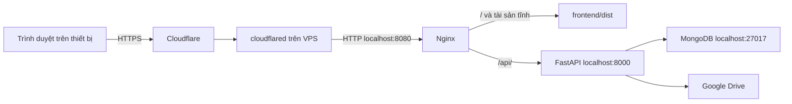
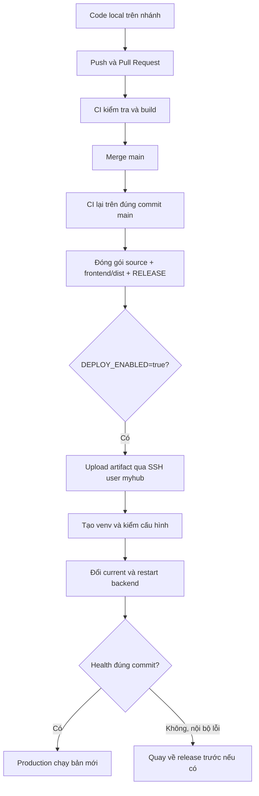

# MyHub — Deploy, CI/CD, vận hành và chuyển máy

**Cập nhật đồng bộ 09/11/2026:** [MYHUB_REALTIME_SYNC.md](MYHUB_REALTIME_SYNC.md) hướng dẫn SSE, cập nhật unit để restart request dài, bật webhook Drive, theo dõi kết nối và lộ trình Redis. Các lệnh triển khai đầu trong tài liệu này được giữ làm lịch sử; áp dụng phần nâng cấp realtime khi dùng phiên bản mới.

Ngày ghi nhận lần triển khai đầu: **06/11/2026**, múi giờ Việt Nam (UTC+7).

Tài liệu ghi lại quy trình đã làm thành công, các lệnh chạy trên máy cá nhân/VPS/GitHub Actions, ý nghĩa và kết quả của chúng. Các phần vận hành và chuyển máy là hướng dẫn dùng về sau, **không phải các thao tác đã được thực hiện trên production**. Lệnh chạy bộ test tự động được lược bỏ; vẫn giữ lệnh xem trạng thái, health và checksum vì cần cho vận hành/chuyển dữ liệu.

Không có mật khẩu, private key, OAuth secret hoặc tunnel token thật trong tài liệu. Thay các giá trị dạng `VPS_IP`, `BACKUP_FILE` bằng giá trị của bạn. Không chạy nguyên các bước khởi tạo trên VPS đang dùng: một số bước chỉ dành cho **máy mới/database trống**.

Chạy từng nhóm theo thứ tự, kiểm tra kết quả rồi mới tiếp tục. Nếu một lệnh lỗi thì dừng tại đó; terminal tương tác không tự đảm bảo các lệnh sau sẽ dừng theo. Các biến PowerShell/Bash cần được khai báo lại nếu mở terminal mới.

Các block PowerShell có thể dán vào terminal. Nếu tách chúng thành file `.ps1` trên Windows PowerShell 5.1, dùng UTF-8 có BOM để các chuỗi tiếng Việt được đọc đúng; script Bash trên Linux dùng LF.

## Mục lục

- [1. Hệ thống đã triển khai](#architecture)
- [2. Toàn bộ quy trình triển khai ban đầu](#initial-deploy)
- [3. Các lệnh của trợ lý và cách CI/CD hoạt động](#cicd)
- [4. Theo dõi realtime frontend, API, backend, database và tunnel](#monitoring)
- [5. Backup và chuyển VPS giữ nguyên dữ liệu](#vps-migration)
- [6. Chuyển môi trường local dev/test sang máy khác](#local-migration)
- [7. Nguồn tham khảo](#references)

<a id="architecture"></a>
## 1. Hệ thống đã triển khai

### 1.1. Thông số và kết quả thực tế

| Thành phần | Giá trị trong lần triển khai đầu |
|---|---|
| Repository | `https://github.com/cdtanhh1807/MyHub.git` (private) |
| Nhánh production | `main` |
| Website | `https://myhub.liamcao.io.vn` |
| API | `https://myhub.liamcao.io.vn/api/v1` |
| Tunnel | `liamcao-vps`, connector chạy trực tiếp bằng service |
| VPS | Ubuntu 22.04 x86_64, 2 CPU, khoảng 3.8 GiB RAM, ổ 50 GB |
| Python trên VPS | 3.13.18 do uv quản lý; Python 3.10 của OS được giữ nguyên |
| Node build trên CI | Node 22; VPS không cần chạy Node để phục vụ frontend |
| Database | MongoDB `8.0.34` trong Docker, database production mới |
| User chạy app/deploy | `myhub`; quản trị bootstrap bằng `root` |
| PR triển khai đầu | [PR #1](https://github.com/cdtanhh1807/MyHub/pull/1) |
| Commit production đầu | `7fdef0d10d3b525bea305a213c291a9717f4eab6` |
| Workflow triển khai đầu | [42169688652](https://github.com/cdtanhh1807/MyHub/actions/runs/42169688652), cả check/deploy thành công |

Sau triển khai, HTTPS, trang đăng nhập, tài sản ảnh và API health đã hoạt động. Người dùng đã báo sử dụng thành công. Danh sách trên là mốc lịch sử; bản chạy hiện tại có thể đổi sau mỗi lần cập nhật main.

### 1.2. Luồng truy cập



Frontend và backend dùng chung hostname nhưng vẫn là hai phần riêng. Nginx chọn dịch vụ theo đường dẫn. Trình duyệt dùng HTTPS; đoạn HTTP từ connector đến Nginx chỉ nằm trên localhost của VPS. Không tạo hostname `api.myhub.liamcao.io.vn` trong cấu hình cuối cùng.

| Cổng | Ai truy cập | Mục đích |
|---|---|---|
| 22 | Máy quản trị, GitHub Actions | SSH/SCP |
| 8080 | Localhost VPS | Nginx, đích của tunnel |
| 8000 | Localhost VPS | FastAPI, đích proxy của Nginx |
| 27017 | Localhost VPS | MongoDB, backend truy cập |

### 1.3. Mã nguồn và dữ liệu nằm ở đâu?

```text
/opt/myhub/
├── incoming/                         # Artifact SHA.tar.gz và checksum
├── releases/<COMMIT_SHA>/             # Một thư mục cho mỗi phiên bản
│   ├── RELEASE                       # Full commit SHA
│   ├── backend/
│   │   ├── .venv/                    # Tạo mới trên VPS, riêng từng release
│   │   └── .env -> /opt/myhub/shared/backend.env
│   └── frontend/dist/                # HTML/CSS/JS đã build
├── current -> releases/<COMMIT_SHA>   # Phiên bản đang được phục vụ
└── shared/                           # Giữ nguyên khi deploy
    ├── backend.env                   # Cấu hình app và khóa bí mật
    ├── bin/                          # uv, uvx
    ├── python/                       # Python managed
    ├── mongodb/                      # Dữ liệu MongoDB do container quản lý
    ├── deploy.lock                   # Khóa tránh deploy/backup đồng thời
    └── data/
        ├── backups/
        ├── cache/
        └── tmp/

/etc/myhub/
├── mongo.env                         # Mật khẩu và thông số khởi tạo DB
├── compose.production.yml
└── mongo-init/01-create-app-user.js

/etc/nginx/sites-available/myhub
/etc/nginx/sites-enabled/myhub        # Symlink đến file trên
/etc/systemd/system/myhub.service
/etc/sudoers.d/myhub
/usr/local/bin/myhub-release
/usr/local/bin/myhub-backup
```

| Dữ liệu | Nơi lưu / điều cần giữ |
|---|---|
| File, folder, Workspace và revision Drive | Google Drive; giữ cùng tài khoản có quyền và `GOOGLE_DRIVE_ROOT_FOLDER_ID` |
| Thiết lập/thứ tự Workspace, người dùng, credential Drive mã hóa | MongoDB; cần backup để chuyển đầy đủ |
| Khóa giải mã credential | `ENCRYPTION_KEY` trong backend.env; database backup không chứa khóa này |
| OAuth client, JWT secret, kết nối DB | backend.env; sao lưu riêng, không đưa vào Git |
| Cache/file tạm | shared/data; thường tạo lại được |
| Phiên đăng nhập/OAuth/upload đang dở | Có thời hạn; không được khôi phục bởi CLI restore |

Đợt đầu **không mang database local lên VPS**: dùng lại Drive root, tạo MongoDB mới rồi đăng nhập/kết nối Drive lại. Đây không phải quy trình chuyển VPS về sau; chuyển VPS cần mang cả metadata và cấu hình như mục 5.

<a id="initial-deploy"></a>
## 2. Toàn bộ quy trình triển khai ban đầu

### 2.1. Chuẩn bị máy cá nhân và tài khoản

Máy cá nhân dùng Windows PowerShell, có Git/OpenSSH và quyền vào repo GitHub. GitHub CLI đã được cài và đăng nhập trước khi triển khai. Nếu dựng một máy quản trị mới, các lệnh chuẩn bị là:

```powershell
winget install --id GitHub.cli --exact
```

Kết quả: cài `gh`; mở lại terminal/VS Code để nhận PATH. Sau đó:

```powershell
gh auth login --hostname github.com --git-protocol https --web
gh auth setup-git
gh auth status
```

| Lệnh | Ý nghĩa / kết quả |
|---|---|
| `gh auth login ... --web` | Đăng nhập qua trình duyệt bằng tài khoản sở hữu repo |
| `gh auth setup-git` | Cấu hình Git dùng credential helper của gh cho GitHub |
| `gh auth status` | Xác nhận tài khoản đang đăng nhập, không cần in token |

Trong lần triển khai, gh có đường dẫn `C:\Program Files\GitHub CLI\gh.exe`. Khi PATH chưa cập nhật, gọi bằng đường dẫn tuyệt đối này. Các biến PowerShell sau chỉ sống trong terminal hiện tại:

```powershell
$taskGh = 'C:\Program Files\GitHub CLI\gh.exe'
$taskRepo = 'cdtanhh1807/MyHub'
$taskVps = Read-Host 'Nhập IP VPS dùng để SSH'
```

`$taskVps` là IP/hostname SSH thật của VPS, không phải URL MyHub qua tunnel. Mở terminal mới thì khai báo lại các biến cần dùng.

### 2.2. Khảo sát VPS trước khi cài — VPS/root

```bash
whoami
uname -m
free -h
df -h /
python3 --version
command -v docker
command -v nginx
sudo ss -ltnp
systemctl is-active cloudflared
```

| Lệnh | Ý nghĩa | Kết quả ghi nhận |
|---|---|---|
| `whoami` | User hiện hành | `root` |
| `uname -m` | Kiến trúc binary cần cài | `x86_64` |
| `free -h` | RAM/swap | Khoảng 3.8 GiB RAM, chưa có swap |
| `df -h /` | Dung lượng hệ thống | Khoảng 43 GB trống lúc bắt đầu |
| `python3 --version` | Python OS | 3.10.4; không dùng cho requirements của app |
| `command -v docker` | Docker đã có chưa | `/usr/bin/docker` |
| `command -v nginx` | Nginx đã có chưa | Chưa cài |
| `ss -ltnp` | Các cổng đang nghe | SSH 22 và metrics nội bộ cloudflared |
| `systemctl is-active cloudflared` | Connector đang chạy không | `active` |

Tunnel đã được người dùng tạo trước đó và dashboard báo Healthy. Việc này chỉ xác nhận connector kết nối Cloudflare; chưa chứng minh có ứng dụng hoặc route.

### 2.3. Cài công cụ nền — VPS/root

```bash
apt-get update
apt-get install -y nginx curl ca-certificates xz-utils unzip openssl
systemctl stop nginx
docker --version
docker compose version
```

| Lệnh | Ý nghĩa / kết quả |
|---|---|
| `apt-get update` | Làm mới danh sách package |
| `apt-get install ...` | Cài Nginx, công cụ tải/giải nén và TLS; không nâng cấp toàn bộ OS |
| `systemctl stop nginx` | Chờ đến khi đã thay cấu hình chỉ nghe localhost |
| Hai lệnh Docker | Xác nhận công cụ đã có; lần đầu ghi nhận Docker 29.9.3, Compose v5.7.0 |

Không cài lại Docker trong lần này. Máy mới chưa có Docker phải cài Docker Engine và Compose plugin theo hướng dẫn Ubuntu chính thức trước khi tiếp tục.

### 2.4. Tạo user, thư mục và Python riêng — VPS/root

```bash
id myhub
```

Nếu chưa có user mới chạy tiếp. Nếu đã có, kiểm tra cấu hình hiện hữu thay vì tạo/ghi đè:

```bash
adduser --disabled-password --gecos '' myhub
install -d -m 755 -o myhub -g myhub /opt/myhub /opt/myhub/releases /opt/myhub/incoming
install -d -m 700 -o myhub -g myhub /opt/myhub/shared /opt/myhub/shared/data /opt/myhub/shared/python /opt/myhub/shared/bin
```

| Thành phần lệnh | Ý nghĩa / kết quả |
|---|---|
| `adduser --disabled-password` | Tạo user `myhub`, home `/home/myhub`, không dùng password cho CI |
| `install -d` | Tạo thư mục và đặt quyền/owner cùng lúc |
| `-o myhub -g myhub` | App/deploy được quản lý thư mục của mình |
| `-m 755` | Release/frontend cho phép Nginx đọc/đi qua thư mục |
| `-m 700` | shared chỉ owner truy cập, bảo vệ cấu hình/runtime |

Cài uv vào vùng riêng:

```bash
curl --proto '=https' --tlsv1.2 -fsSL https://astral.sh/uv/install.sh -o /tmp/myhub-uv-install.sh
runuser -u myhub -- env UV_INSTALL_DIR=/opt/myhub/shared/bin UV_NO_MODIFY_PATH=1 sh /tmp/myhub-uv-install.sh
cd /opt/myhub
runuser -u myhub -- env UV_PYTHON_INSTALL_DIR=/opt/myhub/shared/python UV_PYTHON_BIN_DIR=/opt/myhub/shared/bin /opt/myhub/shared/bin/uv python install 3.13
runuser -u myhub -- env UV_PYTHON_INSTALL_DIR=/opt/myhub/shared/python /opt/myhub/shared/bin/uv python find 3.13
```

| Lệnh / tham số | Ý nghĩa / kết quả |
|---|---|
| `curl ... -o ...` | Tải installer uv chính thức về file, dùng HTTPS |
| `runuser -u myhub -- ...` | Cài/chạy bằng user app, không cài dependencies app dưới root |
| `UV_INSTALL_DIR` | Đặt uv/uvx tại shared/bin |
| `UV_NO_MODIFY_PATH=1` | Không tự sửa shell profile |
| `cd /opt/myhub` | Tránh uv dò `/root/uv.toml` mà user myhub không đọc được |
| `UV_PYTHON_INSTALL_DIR` | Giữ interpreter trong vùng riêng của MyHub |
| `UV_PYTHON_BIN_DIR` | Đặt executable link trong vùng riêng |
| `uv python install 3.13` | Tải Python tương thích; lần đầu cài 3.13.18 |
| `uv python find 3.13` | Trả đường dẫn interpreter; không cần sửa Python OS |

Lỗi đã gặp: chạy uv bằng `runuser` khi cwd vẫn là `/root` gây `Permission denied /root/uv.toml`. Chuyển cwd sang `/opt/myhub` đã giải quyết. Cảnh báo shared/bin chưa nằm trong PATH không ảnh hưởng vì service/script dùng đường dẫn tuyệt đối.

### 2.5. Tạo và chuyển bộ setup — máy cá nhân

Trợ lý tạo `data/myhub-vps-setup.zip` từ các file `deploy/` và `docker/mongo-init/`. Có thể tái tạo bộ này từ source hiện tại như sau, chạy tại gốc repo bằng PowerShell có Python:

```powershell
@'
from pathlib import Path
from zipfile import ZipFile, ZIP_DEFLATED
Path('data').mkdir(exist_ok=True)
with ZipFile('data/myhub-vps-setup.zip', 'w', ZIP_DEFLATED) as archive:
    for root, prefix in [(Path('deploy'), 'deploy'), (Path('docker/mongo-init'), 'mongo-init')]:
        for file in sorted(root.rglob('*')):
            if file.is_file() and '__pycache__' not in file.parts:
                archive.write(file, (Path(prefix) / file.relative_to(root)).as_posix())
'@ | python -
```

Kết quả: zip có `deploy/` và `mongo-init/`, dùng đường dẫn `/` tương thích Linux. Không chứa `.env` thật, private key, DB hoặc data cá nhân. `data/` được Git bỏ qua, nên clone repo không tự có file zip này.

Trong lần đầu, Python được gọi từ `backend/.venv/Scripts/python.exe` thay cho `python` ở cuối lệnh. Dùng `ZipFile` với `as_posix()` tránh đường dẫn backslash do một số bản PowerShell `Compress-Archive` tạo ra.

Chuyển zip:

```powershell
$taskVps = Read-Host 'Nhập IP VPS'
scp -P 22 'C:\Users\cdtan\Documents\Workspace\MyHub\data\myhub-vps-setup.zip' "root@${taskVps}:/root/myhub-vps-setup.zip"
```

`scp -P 22` truyền qua SSH cổng 22. Nhập password root trong terminal. Với host mới, đối chiếu SSH fingerprint từ console VPS trước khi chấp nhận. Máy local ở đường dẫn khác phải đổi đường dẫn nguồn zip.

### 2.6. Sinh cấu hình mới — chỉ lần đầu trên VPS trống

```bash
mkdir /root/myhub-setup
unzip /root/myhub-vps-setup.zip -d /root/myhub-setup
cd /root/myhub-setup
python3 deploy/init_config.py
stat -c '%U %G %a %n' /opt/myhub/shared/backend.env /etc/myhub/mongo.env
```

| Lệnh | Ý nghĩa / kết quả |
|---|---|
| `mkdir` | Tạo thư mục thao tác bootstrap; nếu đã có thì xem lại trước khi giải nén |
| `unzip ... -d ...` | Giải nén file cấu hình/script |
| `init_config.py` | Sinh JWT secret, khóa Fernet, password DB ngẫu nhiên; password app nhất quán với Mongo URI |
| `stat ...` | Xác nhận `myhub myhub 600 .../backend.env` và `root root 600 .../mongo.env` |

Script không in bí mật và từ chối ghi đè cấu hình đã có. Python 3.10 OS chạy được helper này vì nó dùng standard library; backend vẫn dùng Python 3.13. **Không chạy helper sinh khóa này khi chuyển VPS để giữ dữ liệu cũ.**

### 2.7. Google/GitHub OAuth và backend.env

**Google Cloud Console, client Web hiện có:** bật Google Drive API và bổ sung hai Authorized redirect URIs, giữ URI local:

```text
https://myhub.liamcao.io.vn/api/v1/auth/google/callback
https://myhub.liamcao.io.vn/api/v1/auth/drive/callback
```

Nếu Console yêu cầu Authorized domain, dùng `liamcao.io.vn`. Kiểm tra publishing status của OAuth consent: app External ở Testing có thể nhận refresh token Drive hết hạn sau 7 ngày. Chọn cấu hình publishing phù hợp cho việc dùng lâu dài.

**GitHub → Settings → Developer settings → OAuth Apps:** đã tạo app riêng **MyHub Production**:

| Trường | Giá trị |
|---|---|
| Homepage URL | `https://myhub.liamcao.io.vn` |
| Authorization callback URL | `https://myhub.liamcao.io.vn/api/v1/auth/github/callback` |

Tạo Client Secret, giữ app OAuth local riêng để callback localhost vẫn hoạt động.

**VPS/root:**

```bash
nano /opt/myhub/shared/backend.env
```

Điền `GOOGLE_CLIENT_ID`, `GOOGLE_CLIENT_SECRET`, `GOOGLE_DRIVE_ROOT_FOLDER_ID` (root cũ), `GITHUB_CLIENT_ID`, `GITHUB_CLIENT_SECRET`. Lưu bằng Ctrl+O, Enter, thoát Ctrl+X. Kết quả: backend có đủ cấu hình OAuth và Drive, chưa cần kết nối Drive trước khi app chạy.

Các giá trị production đã có trong mẫu:

```dotenv
BACKEND_URL=https://myhub.liamcao.io.vn
FRONTEND_URL=https://myhub.liamcao.io.vn
CORS_ORIGINS=["https://myhub.liamcao.io.vn"]
COOKIE_SECURE=true
LOCAL_DATA_DIR=/opt/myhub/shared/data
```

Không chuyển secret backend vào biến `VITE_*`. CI build frontend với `VITE_API_BASE_URL=/api/v1`; trình duyệt gọi API cùng origin.

### 2.8. Cài file hệ thống và MongoDB — VPS/root

```bash
cd /root/myhub-setup
install -d -m 755 /etc/myhub/mongo-init
install -m 600 deploy/compose.production.yml /etc/myhub/compose.production.yml
install -m 644 mongo-init/01-create-app-user.js /etc/myhub/mongo-init/01-create-app-user.js
install -d -m 700 /opt/myhub/shared/mongodb
install -m 755 deploy/release.sh /usr/local/bin/myhub-release
install -m 755 deploy/backup.sh /usr/local/bin/myhub-backup
install -m 644 deploy/myhub.service /etc/systemd/system/myhub.service
visudo -cf deploy/myhub-sudoers
```

Chỉ nếu `visudo` báo `parsed OK`, tiếp tục:

```bash
install -m 440 deploy/myhub-sudoers /etc/sudoers.d/myhub
docker compose --env-file /etc/myhub/mongo.env -f /etc/myhub/compose.production.yml up -d --wait
docker compose --env-file /etc/myhub/mongo.env -f /etc/myhub/compose.production.yml ps
```

| Lệnh / file | Ý nghĩa / kết quả |
|---|---|
| mongo-init mode 755, JS mode 644 | User Mongo trong container đọc được script init; không chứa password trong JS |
| compose.production.yml | Mongo 8.0.34, loopback 27017, RAM giới hạn 1 GiB, cache 0.25 GiB, restart unless-stopped |
| thư mục shared/mongodb | Bind mount bền vững; Docker/Mongo quản lý ownership bên trong sau lần chạy đầu |
| myhub-release / myhub-backup mode 755 | Script root cài, user myhub được thực thi |
| myhub.service | Một worker FastAPI trong venv; restart on-failure, ghi runtime vào shared/data |
| `visudo -cf` | Kiểm cú pháp trước khi đưa file vào sudoers |
| sudoers mode 440 | Chỉ cho start/stop/restart/reset-failed đúng service `myhub.service`; không cấp Docker/shell root |
| `up -d --wait` | Tải image, khởi tạo DB/app user lần đầu, chạy nền và đợi Healthy |
| `ps` | Lần đầu thấy `myhub-mongodb ... healthy ... 127.0.0.1:27017->27017/tcp` |

Init user chỉ chạy khi thư mục DB rỗng. Đổi password trong mongo.env sau khi đã khởi tạo không tự đổi password trong MongoDB. Không xóa DB để xử lý lỗi password. Không chạy lại bước đặt quyền thư mục Mongo đang hoạt động một cách tùy tiện.

### 2.9. Cài/bật Nginx và enable backend — VPS/root

```bash
cd /root/myhub-setup
install -m 644 deploy/nginx.conf /etc/nginx/sites-available/myhub
ln -s /etc/nginx/sites-available/myhub /etc/nginx/sites-enabled/myhub
if [ -L /etc/nginx/sites-enabled/default ]; then
  unlink /etc/nginx/sites-enabled/default
fi
nginx -t
```

Nếu `syntax is ok` và `test is successful`:

```bash
systemctl daemon-reload
systemctl enable myhub.service nginx.service
systemctl start nginx.service
systemctl is-active nginx.service
ss -ltnp '( sport = :8080 )'
```

| Lệnh | Ý nghĩa / kết quả |
|---|---|
| `install ... nginx.conf` | Cài server phục vụ frontend/dist và proxy `/api/` |
| `ln -s` | Bật site; nếu symlink đã có thì kiểm tra, không ghi đè mù |
| `unlink default` trong điều kiện `-L` | Chỉ bỏ symlink site mặc định của Nginx mới cài |
| `nginx -t` | Kiểm cấu hình trước khi start/reload |
| `daemon-reload` | systemd đọc file service mới |
| `enable` | Bật tự khởi chạy lúc VPS boot; chưa start backend |
| `start nginx` / `is-active` | Nginx chạy, trả `active` |
| `ss ...8080` | Xác nhận chỉ nghe `127.0.0.1:8080` |

Backend chưa start ở giai đoạn này vì chưa có `current` release. Nginx có thể trả 404/502 trước lần deploy đầu.

### 2.10. Route và DNS trên Cloudflare

Vào tunnel **liamcao-vps → Published application routes → Add published application**:

| Trường trên giao diện đã dùng | Nội dung |
|---|---|
| Subdomain | `myhub` |
| Domain | `liamcao.io.vn` |
| Path | Để trống |
| Service URL | `http://127.0.0.1:8080` — gồm cả `http://` |
| Additional HTTP/TLS/Connection/Access settings | Giữ mặc định |

Nhấn **Add route**. Dashboard tạo DNS CNAME tương ứng trỏ vào tunnel. Không thêm A record về IP VPS và không cần DNS riêng cho Mongo/API. Nếu DNS trùng tên đã tồn tại, kiểm tra record đó trước khi sửa; không tạo hai đích khác nhau cho cùng hostname.

Kết quả: `https://myhub.liamcao.io.vn` đi qua tunnel đến Nginx. Tunnel Healthy + route đúng vẫn chưa đủ nếu ứng dụng chưa chạy; 404/502 trước lần deploy đầu là dự kiến. Sau deploy website phục vụ frontend và API trên cùng hostname.

### 2.11. SSH key riêng cho deploy — máy cá nhân và VPS

**PowerShell máy cá nhân:**

```powershell
$taskDeployKey = Join-Path $env:USERPROFILE '.ssh\myhub_ci_ed25519'
New-Item -ItemType Directory -Force (Split-Path $taskDeployKey) | Out-Null
Test-Path $taskDeployKey
```

Nếu True, dừng để giữ key cũ hoặc chọn tên khác. Nếu False:

```powershell
ssh-keygen -t ed25519 -a 64 -f "$taskDeployKey" -C 'myhub-ci-deploy'
```

Nhấn Enter hai lần khi hỏi passphrase để CI dùng không tương tác. Kết quả: private key tại `$taskDeployKey`, public key tại `${taskDeployKey}.pub`. Private key chỉ dùng cho deploy, không commit.

```powershell
$taskVps = Read-Host 'Nhập IP VPS'
scp -P 22 "${taskDeployKey}.pub" "root@${taskVps}:/tmp/myhub-ci-key.pub"
```

**VPS/root:**

```bash
install -d -m 700 -o myhub -g myhub /home/myhub/.ssh
if [ -e /home/myhub/.ssh/authorized_keys ]; then
  echo 'EXISTS: dung lai va kiem tra key hien co'
else
  echo 'NEW: co the tiep tuc'
fi
```

Chỉ khi NEW:

```bash
{ printf 'restrict '; cat /tmp/myhub-ci-key.pub; } > /home/myhub/.ssh/authorized_keys
chown myhub:myhub /home/myhub/.ssh/authorized_keys
chmod 600 /home/myhub/.ssh/authorized_keys
```

`restrict` tắt forwarding/PTY cho key CI; vẫn cho SCP và lệnh deploy không tương tác. Không dùng key này để tạo SSH port-forward phục vụ Compass. Nếu authorized_keys đã có, thêm public key có kiểm soát thay vì ghi đè các key cũ.

**PowerShell:**

```powershell
ssh -T -p 22 -i "$taskDeployKey" -o IdentitiesOnly=yes -o BatchMode=yes "myhub@$taskVps" whoami
```

Kết quả đã nhận: `myhub`, không hỏi password. `-T` không cấp PTY; `IdentitiesOnly` chỉ dùng key chỉ định; `BatchMode` báo lỗi thay vì đợi nhập password. Giữ terminal root quản trị riêng.

### 2.12. Lưu secrets/variable vào GitHub — PowerShell máy cá nhân

```powershell
$taskGh = 'C:\Program Files\GitHub CLI\gh.exe'
$taskRepo = 'cdtanhh1807/MyHub'
$taskDeployKey = Join-Path $env:USERPROFILE '.ssh\myhub_ci_ed25519'
$taskVps = Read-Host 'Nhập IP VPS dùng để SSH'
& $taskGh auth status
```

Lấy host key mà SSH trên máy bạn đã tin cậy:

```powershell
$taskKnownHosts = @(
  ssh-keygen -F "$taskVps" -f "$env:USERPROFILE\.ssh\known_hosts" |
    Where-Object { $_ -and -not $_.StartsWith('#') }
)
$taskKnownHosts.Count
```

Count phải lớn hơn 0. Host key xác nhận máy chủ; nó khác public key của user deploy. Lần kết nối đầu cần đối chiếu fingerprint từ console VPS đáng tin cậy. Không tự lấy host key bất kỳ trên mạng rồi tắt `StrictHostKeyChecking`.

```powershell
& $taskGh secret set DEPLOY_HOST --repo $taskRepo --app actions --body "$taskVps"
& $taskGh secret set DEPLOY_PORT --repo $taskRepo --app actions --body '22'
& $taskGh secret set DEPLOY_USER --repo $taskRepo --app actions --body 'myhub'
Get-Content -LiteralPath $taskDeployKey -Raw |
  & $taskGh secret set DEPLOY_SSH_KEY --repo $taskRepo --app actions
($taskKnownHosts -join "`n") |
  & $taskGh secret set DEPLOY_KNOWN_HOSTS --repo $taskRepo --app actions
& $taskGh variable set DEPLOY_ENABLED --repo $taskRepo --body 'false'
& $taskGh secret list --repo $taskRepo
& $taskGh variable list --repo $taskRepo
```

| Secret / variable | Ý nghĩa / kết quả |
|---|---|
| `DEPLOY_HOST` | IP/hostname SSH của VPS |
| `DEPLOY_PORT` | 22 |
| `DEPLOY_USER` | myhub |
| `DEPLOY_SSH_KEY` | Private key qua stdin, không in ra màn hình |
| `DEPLOY_KNOWN_HOSTS` | Host key để xác minh server trong workflow |
| `DEPLOY_ENABLED=false` | Cho CI chạy nhưng chưa cho CD deploy trong lúc bootstrap |
| `secret list` | Chỉ hiện tên và thời gian cập nhật, không trả giá trị secrets |
| `variable list` | Hiện biến không bí mật và giá trị |

Các mục này ở GitHub repo → Settings → Secrets and variables → Actions. App secrets Google/GitHub/Mongo vẫn ở VPS; Actions không cần đọc chúng.

### 2.13. Bật deployment và nghiệm thu ban đầu

Sau khi người dùng xác nhận triển khai, trợ lý đã chuyển PR khỏi draft, bật `DEPLOY_ENABLED=true` **trước khi merge** để sự kiện push main tự chạy một workflow. Các lệnh và artifact nằm ở mục 3.

Kết quả lần đầu: check → build/package → SSH upload → tạo venv → restart backend → health nội bộ/public đều thành công. Người dùng đăng nhập, chọn **Kết nối Drive** và cấp quyền tài khoản Google có quyền trên root cũ. Các Workspace/file được đọc lại từ Drive. Giao diện đang mở ở thiết bị khác có thể cần reload để lấy frontend mới.

7z/RAR cần CLI Linux riêng nếu muốn dùng đủ định dạng; đặt `SEVEN_ZIP_PATH`/`RAR_PATH` trong backend.env. Nếu chưa cài, giao diện vô hiệu hóa định dạng tương ứng. Giữ yêu cầu giấy phép RAR phù hợp. Việc chuyển hệ điều hành không tự mang theo các công cụ đã cài trên Windows.

<a id="cicd"></a>
## 3. Các lệnh của trợ lý và cách CI/CD hoạt động

### 3.1. Nhánh triển khai và PR — máy cá nhân, gốc repo

Trong lịch sử triển khai, trợ lý đã chạy các nhóm sau. Đây là bản ghi thao tác, không phải yêu cầu chạy lại để tạo PR #1:

```powershell
git status --short --branch
git switch -c feat/vps-deploy-resumable-upload
```

`status` xác nhận nhánh/thay đổi local trước khi thao tác; `switch -c` tạo nhánh riêng từ main. Trợ lý đọc `AGENTS.md`, README, các script/cấu hình bằng `Get-Content` và tìm code liên quan bằng `rg`; những lệnh đọc này không làm thay đổi VPS.

Các thay đổi chính: upload 8 MiB có resume, lưu phiên mã hóa trong MongoDB, health có release SHA, thư mục `deploy/`, workflow `.github/workflows/myhub.yml` và hướng dẫn vận hành.

```powershell
git add -- AGENTS.md README.md VERIFICATION.md .github deploy backend/app backend/scripts/restore_db.py backend/tests frontend/playwright.config.ts frontend/src frontend/tests
git commit -m "Add resumable uploads and VPS deployment pipeline"
git push -u origin feat/vps-deploy-resumable-upload
```

Kết quả: commit `64030b0`, branch có upstream trên GitHub. Lệnh `git add` chỉ stage source/tài liệu; `.env`, data và dependencies vẫn được ignore.

Trợ lý soạn nội dung PR vào file tạm `data/vps-pr-body.md` rồi chạy:

```powershell
& $taskGh pr create --draft --base main --head feat/vps-deploy-resumable-upload --title 'Support large uploads and automated VPS deployments' --body-file data/vps-pr-body.md
```

Kết quả: PR #1 nháp để CI Linux chạy trước khi merge. File body tạm không được commit; khi tạo PR mới phải soạn nội dung mới, không cần tái sử dụng file này.

CI phát hiện nhãn điều hướng bị cắt do font Linux. Trợ lý sửa khoảng đệm và thêm artifact chẩn đoán khi workflow lỗi:

```powershell
git add -- frontend/src/theme/app.css .github/workflows/myhub.yml
git commit -m "Keep navigation labels visible with Linux fonts and retain CI diagnostics"
git push
```

Kết quả: commit `b747172`, CI Linux đạt. Sau đó ghi kết quả và sửa mô tả quyền thư mục mongo-init:

```powershell
git add -- deploy/DEPLOYMENT.md VERIFICATION.md
git commit -m "Record Linux CI verification and clarify Mongo init directory access"
git push
```

Kết quả: commit đầu nhánh PR trước merge là `4f1745a42583ad069bae7518a4611bace9d4feef`; PR mergeable, CI đạt. Các lệnh thực thi test/QA không liệt kê theo phạm vi tài liệu này.

### 3.2. Các lệnh theo dõi đã dùng

```powershell
& $taskGh pr view 1 --json url,state,isDraft,headRefOid,mergeable,statusCheckRollup
& $taskGh pr checks 1
& $taskGh run list --repo cdtanhh1807/MyHub --branch main --limit 3 --json databaseId,status,conclusion,headSha,event
& $taskGh run view 42169688652 --repo cdtanhh1807/MyHub --json status,conclusion,jobs
```

| Lệnh | Mục đích / cách đọc |
|---|---|
| `pr view` | Xác định đúng PR, commit đã xem, trạng thái draft/mergeable và checks |
| `pr checks` | Xem pass/fail của jobs; không tự chạy test bằng lệnh này |
| `run list` | Tìm run ID theo nhánh; `headSha` liên kết bản build với commit |
| `run view ... --json` | Xem tiến độ/kết quả từng job và step |
| `run view RUN_ID --log-failed` | Đọc log lỗi; đã dùng với run CI thất bại do nhãn trên Linux |

Các lệnh đọc trạng thái được lặp lại khi chờ workflow; chỉ ghi một lần ở đây. Trong tương lai thay run ID/PR ID bằng bản cần theo dõi.

### 3.3. Merge/bật deploy thực tế — sau khi người dùng đồng ý

```powershell
& $taskGh pr ready 1 --repo cdtanhh1807/MyHub
& $taskGh variable set DEPLOY_ENABLED --repo cdtanhh1807/MyHub --body true
& $taskGh pr merge 1 --repo cdtanhh1807/MyHub --squash --match-head-commit 4f1745a42583ad069bae7518a4611bace9d4feef --subject 'Deploy MyHub with resumable uploads and automated VPS releases'
git fetch origin
git switch main
git merge --ff-only origin/main
git status --short --branch
git log -1 --format='%h %s'
```

| Lệnh / flag | Ý nghĩa / kết quả |
|---|---|
| `pr ready` | Chuyển PR nháp sang sẵn sàng review/merge |
| `DEPLOY_ENABLED=true` | Bật cổng cho job deploy; đặt trước merge để push main tự kích hoạt |
| `--squash` | Gom các commit PR thành một commit main |
| `--match-head-commit` | Chỉ merge đúng đầu nhánh đã kiểm tra; từ chối nếu PR đổi commit |
| `fetch` | Cập nhật refs remote, không ghi đè working tree |
| `switch main` | Quay local về nhánh production |
| `merge --ff-only` | Đồng bộ local nếu lịch sử cho phép fast-forward; không tạo merge tùy ý |
| `status` / `log` | Main sạch, đồng bộ origin/main, đầu nhánh `7fdef0d` |

Không xóa nhánh remote, không force-push. Workflow đầu là sự kiện `push` do merge, không cần chạy dispatch thêm lần nữa.

### 3.4. Workflow làm gì khi main đổi?



Workflow chạy trên PR hướng main, push main và thao tác Run workflow. Chỉ main và không phải PR mới được deploy. Cả push trực tiếp main cũng kích hoạt, vì vậy thông thường vẫn nên dùng nhánh/PR trước.

CI cài dependencies từ requirements/lockfile. Hai lệnh build frontend trên runner Linux:

```bash
npm ci
npm run build
```

`npm ci` cài đúng package-lock; build tạo `frontend/dist`, không dùng Vite dev server để phục vụ production. Những bước kiểm thử được workflow tự thực hiện, không cần chạy thủ công trên VPS.

Sau khi các bước kiểm tra đạt, runner đóng gói:

```bash
mkdir package
git archive "$GITHUB_SHA" | tar -x -C package
mkdir -p package/frontend/dist
cp -a frontend/dist/. package/frontend/dist/
printf '%s\n' "$GITHUB_SHA" > package/RELEASE
tar -czf "$GITHUB_SHA.tar.gz" -C package .
sha256sum "$GITHUB_SHA.tar.gz" > "$GITHUB_SHA.tar.gz.sha256"
```

| Lệnh | Ý nghĩa / kết quả |
|---|---|
| `git archive` | Lấy source đã track đúng commit, không lấy `.git` hoặc file local bị ignore |
| `cp ... dist` | Bổ sung output build vào gói |
| `printf ... RELEASE` | Ghi danh tính commit, health sẽ trả giá trị này |
| `tar -czf` | Tạo gói release nén |
| `sha256sum` | Tạo file kiểm tra toàn vẹn khi đến VPS |

`GITHUB_SHA` là biến runner; không nhập nguyên block này vào PowerShell. Không commit bí mật vào Git: file nào đã track thì git archive có thể đóng gói file đó.

Artifact release giữ trên GitHub **7 ngày**; chẩn đoán lỗi **3 ngày** theo workflow hiện tại. Artifact hết hạn không xóa release đang nằm trên VPS và không phải lịch lưu backup DB.

Job deploy kiểm main hiện tại để bỏ qua bản đã bị commit mới thay thế; concurrency + `deploy.lock` ngăn deploy/backup chồng nhau. SSH dùng key và known_hosts trong secrets, không dùng password root. Các lệnh runner gửi đến VPS tương đương:

```bash
scp -P "$DEPLOY_PORT" -i ~/.ssh/myhub_deploy -o BatchMode=yes -o StrictHostKeyChecking=yes "$GITHUB_SHA.tar.gz" "$GITHUB_SHA.tar.gz.sha256" "$DEPLOY_USER@$DEPLOY_HOST:/opt/myhub/incoming/"
ssh -p "$DEPLOY_PORT" -i ~/.ssh/myhub_deploy -o BatchMode=yes -o StrictHostKeyChecking=yes "$DEPLOY_USER@$DEPLOY_HOST" "/usr/local/bin/myhub-release '$GITHUB_SHA'"
```

Runner đã tạo key file mode 600 và known_hosts trước các lệnh này. Không chép giá trị secret vào command log. VPS không cần GitHub token để clone repo: nó nhận artifact từ runner.

### 3.5. Những việc script release thực hiện trên VPS

Đọc source đầy đủ tại [deploy/release.sh](deploy/release.sh). Các thao tác chính:

| Lệnh / thao tác | Ý nghĩa / kết quả |
|---|---|
| Kiểm user `myhub`, SHA 40 ký tự hex | Chặn gọi sai user hoặc đường dẫn tùy ý |
| `flock -n` trên shared/deploy.lock | Từ chối nếu backup/deploy khác đang giữ khóa |
| `sha256sum --check SHA.tar.gz.sha256` | Xác nhận archive không đổi trong quá trình chuyển |
| `uv run --no-project --python 3.13 ...` | Giải nén với Python data filter, chặn path/symlink thoát release |
| `ln -s shared/backend.env .../backend/.env` | Dùng cấu hình bền vững, không lấy env từ artifact |
| `uv venv --python 3.13 .../backend/.venv` | Tạo venv cho đúng release |
| `uv pip install --python ... -r .../requirements.txt` | Cài dependencies đã khóa bằng interpreter của release |
| Đọc Settings bằng Python, thông báo đã lọc | Kiểm cấu hình trước khi đổi bản; không in giá trị bí mật |
| `touch .ready` | Đánh dấu đã chuẩn bị xong; release đang chuẩn bị dở không tự được kích hoạt |
| `ln -sfn` rồi `mv -Tf` | Đổi symlink current nguyên tử |
| `sudo -n systemctl reset-failed/restart myhub.service` | Khởi động bản mới bằng quyền sudo giới hạn |
| `curl` health backend và Nginx | Kiểm process lên, đúng commit, Nginx phục vụ được frontend/API |
| Trap rollback | Nếu bước kích hoạt/health nội bộ lỗi, đổi lại bản trước và restart; lần đầu không có bản trước thì dừng service |

Job cuối gọi `https://myhub.liamcao.io.vn/api/v1/health` và so `release` với commit main. Nếu nội bộ đạt nhưng mạng/DNS/tunnel public lỗi, job báo lỗi để xử lý kết nối, không tự rollback code chỉ vì lỗi mạng ngoài.

Backend dùng factory `app.main:create_app`, một worker, host 127.0.0.1, port 8000, `--no-access-log`. Mongo không bị tạo lại mỗi lần deploy. Root-installed script/service/Nginx **không tự được thay bằng bản trong artifact**; nếu tính năng mới cần đổi file hệ thống phải triển khai phần cấu hình đó riêng sau khi xem diff.

### 3.6. Từ nay cập nhật và chạy lại bằng cách nào?

Quy trình bình thường: tạo nhánh → code → commit/push → PR → kiểm tra đạt → merge main → chờ Actions thành công → reload giao diện. Không cần SSH vào VPS để git pull hoặc npm build.

Lệnh điều khiển, chạy trên máy cá nhân đã đăng nhập gh:

```powershell
& $taskGh variable set DEPLOY_ENABLED --repo $taskRepo --body false
& $taskGh variable set DEPLOY_ENABLED --repo $taskRepo --body true
```

Dòng đầu tạm ngưng **deploy mới**, dòng thứ hai bật lại. Chỉ chạy dòng phù hợp; chúng không phải hai dòng cần chạy nối nhau. Đổi biến không tự dừng workflow đang deploy và không tự kích hoạt một lượt deploy mới.

Khi muốn chạy main hiện tại bằng tay:

```powershell
& $taskGh workflow run myhub.yml --repo $taskRepo --ref main
```

Lệnh tạo run mới trên main; cần `DEPLOY_ENABLED=true` để job deploy chạy. Không dùng nó để chạy một nhánh tùy ý lên production. Không chạy thêm khi đã có deploy cùng bản đang hoạt động.

Deploy có khoảng restart ngắn, không phải zero downtime. Rollback code không đảo ngược dữ liệu/migration DB. Hiện không có migration phá dữ liệu hoặc restore DB tự động trong pipeline; thay đổi schema về sau phải đi kèm kế hoạch tương thích/backup.

<a id="monitoring"></a>
## 4. Theo dõi realtime frontend, API, backend, database và tunnel

Phần này là các thao tác vận hành bổ sung; không có nghĩa đã bật thêm logging, SSH tunnel hay lịch theo dõi trên VPS.

### 4.1. Xem các API thực sự được gọi trên thiết bị

Trên Chrome/Edge mở MyHub → F12 → **Network**:

1. Bật **Preserve log** để giữ request khi redirect/reload. Bật **Disable cache** khi đang mở DevTools nếu muốn quan sát tải frontend mới.
2. Chọn **Fetch/XHR**, lọc `/api/v1/`, rồi thao tác trên giao diện.
3. Chọn request: xem **Headers** (URL/method/status), **Payload**, **Preview/Response**, **Timing**.
4. Với PDF/video/download, chuyển **All/Media** để thấy request Range. Với login chuyển **All/Doc** để thấy redirect OAuth.
5. Xem **Console** để phân biệt lỗi JavaScript với lỗi HTTP/backend. Tab **Application** cho biết cookie/storage, nhưng không chia sẻ giá trị token/cookie.

Các endpoint tiêu biểu, đều có prefix `/api/v1`:

| Thao tác | Request chính |
|---|---|
| Khởi tạo/gia hạn phiên web | `POST /auth/refresh` |
| Bắt đầu đăng nhập | `GET /auth/google/login` hoặc `/auth/github/login` |
| Bắt đầu kết nối Drive | `POST /drive-connection/authorize` |
| Đọc trạng thái Drive | `GET /drive-connection` |
| Danh sách Workspace | `GET /workspaces` |
| Thiết lập giao diện | `GET` / `PUT /settings` |
| Danh sách file | `GET /workspaces/{workspace_id}/files` |
| Tạo phiên upload | `POST /workspaces/{workspace_id}/uploads` |
| Gửi từng phần | `PUT /workspaces/{workspace_id}/uploads/{upload_id}?offset=...` |
| Đối chiếu tiến độ / hủy | `GET` / `DELETE` cùng URL session |
| Nội dung editor | `GET` / `PUT /workspaces/{workspace_id}/files/{file_id}/text` |
| Xin cookie media | `POST /workspaces/{workspace_id}/files/{file_id}/access` |
| Tải/stream file | `GET .../content`, có thể trả 206 khi có Range |
| Preview/PDF/archive | `GET .../preview`, `.../pdf`, `.../archive` |
| Quyền chia sẻ / lịch sử | `.../permissions`, `.../revisions` |

Upload mới tối đa 8 MiB/request, dù tổng file hơn 100 MB. `308 Resume Incomplete` là phản hồi giữa backend và Google; browser nhận DTO tiến độ từ MyHub. Session tồn tại tối đa 6 ngày; chọn lại cùng file trong cùng tab sau reload có thể tiếp tục. Chưa có resume liên thiết bị hoặc sau khi xóa sessionStorage.

Không gửi HAR/Copy as cURL nguyên bản cho người khác: chúng có thể chứa Authorization, Cookie, OAuth code, tên file và nội dung cá nhân. Khi báo lỗi, thường chỉ cần method, đường dẫn đã ẩn ID nếu cần, status, error.code và thời điểm.

### 4.2. Backend và trạng thái bản đang chạy — VPS/root

Mở một terminal SSH riêng để theo dõi:

```bash
journalctl -u myhub.service -f -n 100 -o short-iso
```

`-u` chọn service, `-f` theo dõi tiếp, `-n 100` lấy 100 dòng gần nhất, `short-iso` thêm mốc thời gian. Ctrl+C chỉ thoát chế độ theo dõi, không dừng backend.

```bash
systemctl is-active myhub.service
systemctl status myhub.service --no-pager
readlink -f /opt/myhub/current
cat /opt/myhub/current/RELEASE
curl -fsS http://127.0.0.1:8000/api/v1/health
curl -fsS http://127.0.0.1:8080/api/v1/health
curl -fsS https://myhub.liamcao.io.vn/api/v1/health
```

| Lệnh | Kết quả / cách chẩn đoán |
|---|---|
| is-active / status | `active`, PID, thông tin startup/lỗi |
| readlink / RELEASE | Full commit của release đang được chọn |
| curl port 8000 | Backend trực tiếp |
| curl port 8080 | Backend qua Nginx |
| curl HTTPS | Toàn bộ DNS/TLS/tunnel/Nginx/backend |

Health dự kiến có `status: ok`, `version`, `release`. Nó chứng minh startup đã qua bước khởi tạo Mongo và process trả lời; **không ping lại Mongo/Drive trên từng lần health**. Drive ngắt quyền hoặc Mongo lỗi sau startup cần xem API nghiệp vụ/log/DB riêng.

Backend đang tắt Uvicorn access log để hạn chế ghi OAuth code/state vào log. Vì vậy journal **không phải danh sách mọi request**; dùng Network/Nginx để xem API được gọi. Journal vẫn có startup và exception. Không bật debug/raw request logging toàn bộ trên production chỉ để đếm API.

### 4.3. Frontend và Nginx realtime

Frontend production là file tĩnh, không có process `npm run dev` hoặc frontend journal riêng. Log phục vụ trang và proxy API nằm ở Nginx. Với cài đặt Ubuntu hiện tại, khi chưa tùy chỉnh logging, thường dùng:

```bash
tail -F /var/log/nginx/access.log
tail -F /var/log/nginx/error.log
```

Chạy mỗi lệnh ở terminal riêng. `-F` tiếp tục theo dõi khi logrotate thay file. Log mặc định có thể chứa URL/query OAuth; đọc tại chỗ, không đưa nguyên log vào chat/repo.

**Tùy chọn để theo dõi API bằng access log hạn chế dữ liệu:** chưa được áp dụng tự động. Root tạo `/etc/nginx/conf.d/myhub-observability.conf` bằng editor với nội dung sau (file nằm trong context `http`):

```nginx
log_format myhub_safe escape=json
  '{"time":"$time_iso8601","method":"$request_method","path":"$uri",'
  '"status":$status,"bytes":$body_bytes_sent,"seconds":$request_time,'
  '"upstream_seconds":"$upstream_response_time"}';
```

Thêm hai dòng **bên trong server block** của `/etc/nginx/sites-available/myhub`:

```nginx
access_log /var/log/nginx/myhub-access.log myhub_safe;
error_log /var/log/nginx/myhub-error.log warn;
```

Sau khi xem lại thay đổi:

```bash
nginx -t
systemctl reload nginx
tail -F /var/log/nginx/myhub-access.log
```

Chỉ reload khi cấu hình hợp lệ. Access log tùy chọn này dùng `$uri`, không ghi query, Authorization, Cookie hay body; giúp xem method/path/status/thời gian. Error log vẫn có thể chứa ngữ cảnh URL khi lỗi, nên tiếp tục giữ kín. Muốn giữ thay đổi qua lần cài lại config, ghi nhận nó vào cấu hình được quản lý trong repo sau khi được duyệt.

### 4.4. MongoDB realtime và truy vấn có chọn lọc

**VPS/root, chỉ xem trạng thái và tài nguyên:**

```bash
docker compose --env-file /etc/myhub/mongo.env -f /etc/myhub/compose.production.yml ps
docker logs --follow --tail 100 myhub-mongodb
docker stats myhub-mongodb
```

`ps` cho container/health; logs cho startup/lỗi engine; stats hiển thị CPU/RAM/I/O liên tục. Ctrl+C thoát theo dõi, không dừng container. Logs Mongo mặc định không ghi mọi query ứng dụng; chưa bật profiler/change streams/dashboard giám sát riêng.

Mở mongosh, xác thực bằng biến đã có bên trong container mà không đặt password thật trên dòng lệnh:

```bash
docker exec -it myhub-mongodb mongosh --quiet --shell --eval '
db = db.getSiblingDB(process.env.MONGO_INITDB_DATABASE);
db.auth(process.env.MONGO_APP_USERNAME, process.env.MONGO_APP_PASSWORD);
'
```

Trong mongosh:

```javascript
db.getName()
db.getCollectionNames()
db.users.countDocuments({})
db.workspace_orders.countDocuments({})
db.user_settings.countDocuments({})
db.upload_sessions.find({}, { _id: 0, size: 1, offset: 1, expires_at: 1 }).limit(10)
exit
```

Các lệnh chỉ đọc: tên DB/collections, số bản ghi, tiến độ upload chưa chứa URL session. Không dump `drive_credentials`, refresh token hoặc upload session nguyên bản để báo lỗi. Tài khoản app có quyền readWrite; thao tác insert/update/delete trực tiếp ở mongosh/Compass sẽ thay đổi dữ liệu thật.

**MongoDB Compass trên máy cá nhân — tùy chọn:** dùng SSH quản trị, không dùng key CI có `restrict`:

```powershell
$taskVps = Read-Host 'Nhập IP VPS'
ssh -N -p 22 -L 127.0.0.1:27018:127.0.0.1:27017 "root@$taskVps"
```

Giữ terminal mở. Trong Compass kết nối host `127.0.0.1`, port `27018`, database/authSource `myhub`, username app và password lấy riêng từ cấu hình. Có thể dùng URI không chứa password:

```text
mongodb://127.0.0.1:27018/myhub?authSource=myhub
```

Điền username/password trong phần Authentication. `-N` không chạy remote command, `-L` chỉ mở cổng loopback trên máy cá nhân, không public Mongo trên VPS. Ctrl+C đóng đường hầm. Nếu cổng 27018 đã dùng, chọn cổng local khác và sửa Compass tương ứng.

### 4.5. Tunnel và tài nguyên host

```bash
systemctl is-active cloudflared
systemctl show cloudflared --property=ActiveState,SubState,MainPID --no-pager
journalctl -u cloudflared -f -n 100 -o short-iso
uptime
free -h
df -h /
du -sh /opt/myhub/releases /opt/myhub/incoming /opt/myhub/shared/data
```

Ý nghĩa: trạng thái connector/PID, kết nối hoặc lỗi tunnel, tải CPU/RAM, dung lượng ổ và các thư mục app. Dashboard Cloudflare cho biết connector/route Healthy. Không dán toàn bộ `systemctl cat cloudflared`, `docker inspect` hoặc process environment: có thể lộ tunnel token/password.

### 4.6. Theo dõi CI/CD từ máy cá nhân

```powershell
& $taskGh run list --repo $taskRepo --branch main --limit 5
& $taskGh run watch RUN_ID --repo $taskRepo --exit-status
& $taskGh run view RUN_ID --repo $taskRepo --log-failed
```

Thay RUN_ID bằng số từ run list. `watch` cập nhật tiến độ và trả exit code lỗi khi workflow thất bại; Ctrl+C chỉ ngừng theo dõi. Có thể dùng GitHub → Actions để xem từng step và tải artifact còn hạn. Mục này là lệnh theo dõi, không chạy test suite mới ở local.

### 4.7. Đọc nhanh các tình huống thường gặp

| Hiện tượng | Nơi xem tiếp |
|---|---|
| 8000 không trả lời | myhub.service, journal, Mongo/config |
| 8000 OK nhưng 8080 lỗi | Nginx config/error log |
| 8080 OK nhưng domain lỗi | DNS, certificate, tunnel/route |
| 401 `/auth/refresh` lúc chưa đăng nhập | Có thể bình thường: chưa có cookie; kiểm tra UI vẫn hiện trang login |
| 403 | error.code, whitelist/quyền Drive/scope Workspace |
| 409 | error.code: có thể Drive chưa kết nối, editor conflict hoặc offset cần đối chiếu |
| 413 | Xem body của request nào quá giới hạn; frontend mới phải gửi từng phần 8 MiB |
| 422 | DTO/config đầu vào không hợp lệ, đọc error fields đã lọc |
| Backend OK, trang vẫn bản cũ | Reload, Disable cache; đối chiếu health.release với main |
| Actions check pass, deploy skipped | Xem nhánh/event và `DEPLOY_ENABLED` |
| Actions SSH fail | Host/port/key/known_hosts/firewall SSH; không tắt kiểm host key để chữa lỗi |
| Archive timeout | Job đóng gói dài có thể vượt thời gian Cloudflare; chunk upload không thay đổi giới hạn này |

<a id="vps-migration"></a>
## 5. Backup và chuyển VPS giữ nguyên dữ liệu

### 5.1. Kết quả cần bảo toàn và giới hạn

Chuyển sang VPS khác phải giữ: cùng code/release phù hợp, Drive root và file ID, Mongo metadata/thiết lập, OAuth client, khóa mã hóa, cấu hình dịch vụ, domain/route và quyền deploy. Chỉ clone source hoặc chỉ giữ folder Drive sẽ không mang đầy đủ thiết lập Mongo.

Các ngoại lệ có chủ đích: cần đăng nhập lại sau restore; OAuth state và upload đang dở không phục hồi; cache/PDF/file tạm tạo lại được. Kết nối Drive đã hoàn tất có thể được giữ nếu restore credential bằng **đúng encryption key và Google OAuth client cũ**. Cookie/storage trên từng trình duyệt không được chuyển bằng database backup.

Backup của MyHub là BSON Extended JSONL gzip của app DB, không phải bản sao toàn Mongo server, không chứa account quản trị Mongo hoặc encryption key. Nó cũng **không backup nội dung Drive**; file đã xóa vĩnh viễn khỏi Drive cần một phương án backup Drive riêng.

Restore dựng lại các index do code MyHub quản lý. Nếu sau này tự thêm index/role hoặc cấu hình Mongo ngoài code, cần ghi nhận và dựng lại riêng; không coi JSONL backup là bản sao mọi cấu hình engine.

### 5.2. Backup thường ngày trên VPS hiện tại

Root chạy:

```bash
runuser -u myhub -- /usr/local/bin/myhub-backup
```

Script giữ cùng khóa với deploy, dừng backend, chạy backup_db.py, rồi start backend lại bằng EXIT trap dù upload backup lên Drive lỗi. Kết quả mong đợi:

```text
/opt/myhub/shared/data/backups/backup-<UTC timestamp>.jsonl.gz
Một file cùng tên trong .myhub-system của Drive root
```

Có gián đoạn API trong thời gian snapshot/upload backup. Nếu Drive lỗi, file local đã tạo vẫn được giữ; kiểm tra lỗi và file trước khi coi backup thành công. CLI restore chấp nhận nội dung giải nén tối đa 512 MiB; đường tải backup từ Drive còn giới hạn file nén 256 MiB. Khi metadata vượt các mức này cần nâng quy trình backup/restore có kiểm soát trước khi chuyển máy.

Hiện **chưa có cron/systemd timer backup tự động**. CI/CD không thay thế backup và không backup DB ở mỗi deploy. Giữ thêm bản backend.env/khóa và thông tin quản trị Mongo ở password manager/kho riêng ngoài VPS; không chỉ để tất cả bản backup trên cùng đĩa VPS.

### 5.3. Kế hoạch chuyển VPS có khoảng bảo trì

Quy trình dưới đây ưu tiên nhất quán và dễ đối chiếu, không cam kết zero downtime. Giữ VPS cũ đến khi máy mới đã được nghiệm thu và có backup mới. Chưa hủy VPS cũ ngay khi website máy mới vừa mở được.

| Giai đoạn | Thao tác | Trạng thái |
|---|---|---|
| Chuẩn bị | Dựng user/Python/Docker/Nginx ở máy mới | VPS cũ vẫn phục vụ |
| Chốt dữ liệu | Tạm ngưng CD, dừng backend cũ, backup cuối | Bắt đầu bảo trì API |
| Khôi phục | Chuyển gói code/config/backup, restore trên máy mới | Máy mới chưa public |
| Chuyển truy cập | Thay connector của tunnel khi máy mới sẵn sàng | Domain/DNS có thể giữ nguyên |
| Nghiệm thu | Đối chiếu data, cập nhật SSH secrets, bật CD | Máy mới trở thành nguồn ghi chính |

Chọn máy mới cùng Ubuntu/x86_64 giúp tái sử dụng cấu hình. Nếu đổi kiến trúc/OS/Mongo major version phải kiểm tra tương thích riêng. Không copy `.venv` hoặc DB directory đang hoạt động sang máy khác.

### 5.4. Chuẩn bị máy mới trước khi dừng nguồn

1. Cài Docker Engine + Compose nếu chưa có, cài các package ở mục 2.3.
2. Tạo user/thư mục và Python theo mục 2.4. Đứng ở `/opt/myhub` khi chạy uv bằng myhub.
3. Chưa cài/chạy connector dùng tunnel production trên máy mới. Chuẩn bị binary cloudflared được, nhưng giữ connector mới chưa hoạt động.
4. Chưa chạy `init_config.py`: sẽ dùng cấu hình/khóa từ VPS cũ.
5. Chưa cho GitHub Actions deploy đến máy mới; giữ secrets đang trỏ máy cũ cho đến khi cutover sẵn sàng.
6. Cài 7z/RAR/các công cụ ngoài Python tương đương máy cũ nếu đã dùng; giữ đường dẫn CLI phù hợp.

### 5.5. Tạm ngưng CD và chốt snapshot — máy cá nhân + VPS cũ

**PowerShell máy cá nhân:**

```powershell
& $taskGh variable set DEPLOY_ENABLED --repo $taskRepo --body false
& $taskGh run list --repo $taskRepo --branch main --limit 5
```

Chờ lượt deploy đang chạy kết thúc. Biến false không hủy lượt đang hoạt động. Tạm ngừng merge/thay đổi main trong cửa sổ chuyển máy, đợi upload/archive đang chạy hoàn tất hoặc hủy chúng.

**VPS cũ/root:** ghi lại release thực tế, không tự lấy main mới hơn để thay vào snapshot:

```bash
readlink -f /opt/myhub/current
cat /opt/myhub/current/RELEASE
docker compose --env-file /etc/myhub/mongo.env -f /etc/myhub/compose.production.yml ps
```

Dừng và tạm disable backend cũ để nó không tự lên khi vô tình reboot trong lúc chuyển:

```bash
systemctl disable --now myhub.service
cd /opt/myhub/current/backend
flock -n /opt/myhub/shared/deploy.lock runuser -u myhub -- /opt/myhub/current/backend/.venv/bin/python scripts/backup_db.py
```

Lệnh cuối giữ khóa chống deploy/backup khác, tạo backup nhưng **không tự bật backend lại**. Khác với `/usr/local/bin/myhub-backup`, đây là lần chốt dữ liệu để nguồn giữ trạng thái dừng. Nếu lỗi, dừng quy trình, kiểm tra; không tiếp tục với file `.part` hoặc bản backup chưa xác nhận. Trong cửa sổ này không chỉnh trực tiếp file/Workspace trên Drive và không chạy local vào cùng production root.

### 5.6. Tạo gói chuyển máy — VPS cũ/root

Mỗi nhóm lệnh phải thành công trước khi tiếp tục. Ở cùng terminal root, khai báo tên backup **đúng theo output vừa tạo**:

```bash
umask 077
taskBackup=/opt/myhub/shared/data/backups/BACKUP_FILE.jsonl.gz
test -f "$taskBackup"
taskSha=$(cat /opt/myhub/current/RELEASE)
taskTag=$(date -u +%Y%m%dT%H%M%SZ)
taskStage="/root/myhub-migration-$taskTag"
install -d -m 700 "$taskStage"
printf '%s\n' "$taskSha" > "$taskStage/RELEASE.txt"
cp "$taskBackup" "$taskStage/database.jsonl.gz"
cp /opt/myhub/shared/backend.env "$taskStage/backend.env"
cp /etc/myhub/mongo.env "$taskStage/mongo.env"
cp /etc/myhub/compose.production.yml "$taskStage/compose.production.yml"
cp -R /etc/myhub/mongo-init "$taskStage/mongo-init"
cp /etc/nginx/sites-available/myhub "$taskStage/nginx.conf"
cp /etc/systemd/system/myhub.service "$taskStage/myhub.service"
cp /etc/sudoers.d/myhub "$taskStage/myhub-sudoers"
cp /usr/local/bin/myhub-release "$taskStage/release.sh"
cp /usr/local/bin/myhub-backup "$taskStage/backup.sh"
```

Kết quả: snapshot DB + các cấu hình **đang dùng thật**, bao gồm khóa cũ. Nếu đã thêm file logging theo mục 4.3, giữ cả file định nghĩa log format:

```bash
if [ -f /etc/nginx/conf.d/myhub-observability.conf ]; then
  cp /etc/nginx/conf.d/myhub-observability.conf "$taskStage/myhub-observability.conf"
fi
```

Nếu có thêm systemd drop-in/config ngoài các đường dẫn này sau lần triển khai đầu, ghi nhận và mang các phần phụ thuộc đó tương ứng. Không copy nguyên cấu hình SSH host identity của VPS cũ sang máy mới.

**Mang đúng artifact code đang chạy.** Nếu incoming còn artifact gốc:

```bash
cp "/opt/myhub/incoming/$taskSha.tar.gz" "$taskStage/$taskSha.tar.gz"
```

Nếu file không còn, không chạy lệnh copy thất bại rồi bỏ qua: chọn một trong hai cách khôi phục artifact trước khi tiếp tục. Tải artifact cùng commit từ Actions nếu còn hạn; hoặc với release không bị sửa tay, đóng gói current bằng lệnh thay thế sau:

```bash
tar --exclude='*/.env' --exclude='./backend/.venv' --exclude='./.ready' --exclude='*/__pycache__' --exclude='*/.pytest_cache' -czf "$taskStage/$taskSha.tar.gz" -C /opt/myhub/current .
```

Lệnh thay thế lấy cả frontend/dist và RELEASE, bỏ venv, env symlink, marker `.ready` và cache. Không sửa trực tiếp source trong release; nếu đã hotfix ngoài Git phải đối chiếu nội dung thật với repo trước khi coi SHA là danh tính bản phát hành.

Ghi checksum và đóng gói:

```bash
cd "$taskStage"
sha256sum "$taskSha.tar.gz" > "$taskSha.tar.gz.sha256"
sha256sum database.jsonl.gz > database.jsonl.gz.sha256
cd /root
tar -czf "myhub-migration-$taskTag.tar.gz" -C "$taskStage" .
sha256sum "myhub-migration-$taskTag.tar.gz" > "myhub-migration-$taskTag.tar.gz.sha256"
chmod 600 "myhub-migration-$taskTag.tar.gz" "myhub-migration-$taskTag.tar.gz.sha256"
printf 'Migration bundle: /root/myhub-migration-%s.tar.gz\n' "$taskTag"
```

Gói này **có bí mật thật**; giữ ngoài Git, trong nơi lưu riêng và truyền bằng SSH. Nó không chứa raw MongoDB volume hay nội dung file Drive. Checksum phát hiện file truyền bị đổi/hỏng, không thay thế kiểm tra đúng SSH host.

### 5.7. Chuyển gói qua máy cá nhân tới VPS mới

PowerShell tại gốc MyHub, dùng thư mục data bị Git ignore:

```powershell
$taskOldVps = Read-Host 'IP VPS cũ'
$taskNewVps = Read-Host 'IP VPS mới'
$taskBundle = Read-Host 'Tên file myhub-migration-UTC.tar.gz vừa tạo'
$taskTransferDir = Join-Path (Get-Location) 'data\migration'
New-Item -ItemType Directory -Force $taskTransferDir | Out-Null
scp -P 22 "root@${taskOldVps}:/root/$taskBundle" "root@${taskOldVps}:/root/${taskBundle}.sha256" "$taskTransferDir"
scp -P 22 (Join-Path $taskTransferDir $taskBundle) (Join-Path $taskTransferDir "${taskBundle}.sha256") "root@${taskNewVps}:/root/"
```

Hai nguồn trong mỗi lệnh SCP là archive và checksum. Dùng cổng thực tế nếu khác 22. Xác minh host key của máy mới từ console nhà cung cấp; không bỏ kiểm tra host key. Không lưu gói bí mật trong folder được tự đồng bộ/chia sẻ công khai.

### 5.8. Khôi phục cấu hình và database — VPS mới/root

Thay tên file đúng đã chuyển; chọn thư mục restore chưa tồn tại:

```bash
cd /root
taskBundle=myhub-migration-UTC.tar.gz
sha256sum --check "$taskBundle.sha256"
install -d -m 700 /root/myhub-restore
tar -xzf "$taskBundle" -C /root/myhub-restore
cd /root/myhub-restore
sha256sum --check database.jsonl.gz.sha256
taskSha=$(cat RELEASE.txt)
sha256sum --check "$taskSha.tar.gz.sha256"
```

Chỉ tiếp tục khi checksum đều OK. Gói được tạo từ nguồn do bạn quản lý; không giải nén archive lạ bằng root. Các thư mục/user/Python ở mục 5.4 phải có sẵn.

```bash
install -d -m 700 /etc/myhub
install -m 600 -o myhub -g myhub backend.env /opt/myhub/shared/backend.env
install -m 600 mongo.env /etc/myhub/mongo.env
install -m 600 compose.production.yml /etc/myhub/compose.production.yml
install -d -m 755 /etc/myhub/mongo-init
install -m 644 mongo-init/01-create-app-user.js /etc/myhub/mongo-init/01-create-app-user.js
install -d -m 700 /opt/myhub/shared/mongodb
install -m 755 release.sh /usr/local/bin/myhub-release
install -m 755 backup.sh /usr/local/bin/myhub-backup
install -m 644 myhub.service /etc/systemd/system/myhub.service
visudo -cf myhub-sudoers
```

Khi sudoers hợp lệ:

```bash
install -m 440 myhub-sudoers /etc/sudoers.d/myhub
docker compose --env-file /etc/myhub/mongo.env -f /etc/myhub/compose.production.yml up -d --wait
install -m 644 nginx.conf /etc/nginx/sites-available/myhub
if [ -f myhub-observability.conf ]; then
  install -m 644 myhub-observability.conf /etc/nginx/conf.d/myhub-observability.conf
fi
ln -s /etc/nginx/sites-available/myhub /etc/nginx/sites-enabled/myhub
if [ -L /etc/nginx/sites-enabled/default ]; then
  unlink /etc/nginx/sites-enabled/default
fi
nginx -t
```

Chỉ start/reload khi Nginx hợp lệ. DB mới dùng cùng mongo.env nên app password cũ được tạo lại trên **database trống**. `backend.env` giữ encryption key, JWT secret, Drive root và OAuth cũ. Không chạy `init_config.py` và không sinh encryption key mới ở quy trình này.

```bash
systemctl daemon-reload
systemctl enable myhub.service nginx.service
systemctl start nginx.service
install -m 644 -o myhub -g myhub "$taskSha.tar.gz" "/opt/myhub/incoming/$taskSha.tar.gz"
install -m 644 -o myhub -g myhub "$taskSha.tar.gz.sha256" "/opt/myhub/incoming/$taskSha.tar.gz.sha256"
runuser -u myhub -- /usr/local/bin/myhub-release "$taskSha"
```

Script dựng venv đúng máy mới, chuyển current và khởi động app. Lúc này app chỉ truy cập nội bộ vì connector mới chưa nối production. Nó có thể khởi tạo collections trống trước khi restore.

Dừng backend đích và đưa backup vào nơi user app đọc được:

```bash
systemctl stop myhub.service
install -d -m 700 -o myhub -g myhub /opt/myhub/shared/data/backups
install -m 600 -o myhub -g myhub /root/myhub-restore/database.jsonl.gz /opt/myhub/shared/data/backups/migration.jsonl.gz
cd /opt/myhub/current/backend
runuser -u myhub -- /opt/myhub/current/backend/.venv/bin/python scripts/restore_db.py /opt/myhub/shared/data/backups/migration.jsonl.gz --include-drive-credentials --confirm-replace
```

| Flag / thao tác | Ý nghĩa / kết quả |
|---|---|
| File local | Không cần bootstrap kết nối Drive chỉ để tải backup |
| `--include-drive-credentials` | Mang credential mã hóa từ DB backup; dùng encryption key và Google client cũ để giải mã/refresh |
| `--confirm-replace` | Xác nhận thay metadata đích, chỉ chạy khi biết đang trỏ DB máy mới |
| Staging rồi rename | Kiểm định dạng trước, nạp collection tạm rồi thay từng collection |
| Thu hồi sessions | Bắt đăng nhập lại; không phục hồi OAuth/upload đang dở |

Restore không phải transaction toàn database. Nếu đích đã có dữ liệu dùng thật thì phải backup đích trước; không dùng quy trình database trống để ghi đè tùy tiện. Nếu restore lỗi, giữ API dừng và xử lý trước khi bật domain. Khi xong:

```bash
systemctl start myhub.service
curl -fsS http://127.0.0.1:8000/api/v1/health
curl -fsS http://127.0.0.1:8080/api/v1/health
```

So release, collections/metadata với nguồn; loại trừ sessions/state/upload có chủ đích bị xóa. Backend/DB phải hoạt động nội bộ trước khi cutover.

### 5.9. Chuyển tunnel sang máy mới mà giữ domain/DNS

Với mô hình hiện tại chỉ phục vụ MyHub, cách đơn giản là **thay connector của cùng tunnel `liamcao-vps`**. Route vẫn là hostname cũ → `http://127.0.0.1:8080`; DNS CNAME/tunnel ID không đổi; OAuth callback không đổi.

Cloudflare có thể phân phối traffic đến các connector cùng tunnel. Không để hai connector phục vụ hai MongoDB độc lập đồng thời rồi coi đó là replication. [Cơ chế replica chính thức](https://developers.cloudflare.com/tunnel/configuration/)

1. Trên dashboard mở tunnel hiện tại, lấy hướng dẫn/token **Install connector** dành cho Linux của tunnel đó. Không tạo tunnel mới nếu chọn cách giữ tunnel ID này.
2. Trên VPS mới, cài binary cloudflared theo dashboard/nguồn chính thức. Đối với Ubuntu x86_64, cách cài qua gói phát hành hiện hành có dạng:

   ```bash
   curl -fL https://github.com/cloudflare/cloudflared/releases/latest/download/cloudflared-linux-amd64.deb -o /tmp/myhub-cloudflared.deb
   dpkg -i /tmp/myhub-cloudflared.deb
   cloudflared --version
   ```

   Đây là hướng dẫn máy mới, không phải lệnh đã được ghi nhận khi tạo tunnel ban đầu. Chọn đúng binary nếu kiến trúc khác. Nếu host đã có cloudflared/service, xem cấu hình trước khi cài chồng.

3. Chỉ khi app mới đã restore và health nội bộ OK, **VPS cũ/root** chạy:

   ```bash
   systemctl disable --now cloudflared.service
   ```

   Backend cũ vẫn đang disable từ bước chốt dữ liệu. Domain có thể gián đoạn cho đến khi connector mới lên. Nếu tunnel còn phục vụ ứng dụng khác, cần kế hoạch chuyển riêng các ứng dụng đó trước khi dừng toàn connector.

4. **VPS mới/root:** cài service với token cùng tunnel. Có thể nhập token kín thay vì ghi giá trị thật vào shell history:

   ```bash
   read -r -s -p 'Tunnel token: ' taskTunnelToken
   printf '\n'
   cloudflared service install "$taskTunnelToken"
   unset taskTunnelToken
   systemctl enable --now cloudflared.service
   systemctl is-active cloudflared.service
   ```

   Lệnh lưu cấu hình service cần token; giữ máy/nhật ký cấu hình đó kín. Không đưa token thật vào tài liệu, chat hoặc repo.

5. Dashboard phải thấy connector máy mới Healthy. Truy cập domain, kiểm health đúng SHA, đăng nhập lại, đọc Workspace/thiết lập, tải và ghi một file do bạn chọn để xác nhận quyền Drive. Không cấp lại Drive nếu credential đã phục hồi hoạt động; nếu bị provider thu hồi thì kết nối lại bằng cùng tài khoản/root.

Nếu muốn **tunnel ID mới**, phải tạo route ở tunnel mới và chuyển DNS CNAME của hostname sang UUID mới có kiểm soát. DNS/route cùng tên có thể trùng record cũ: xem và sửa record hiện có sau khi đích sẵn sàng, không tạo A record về VPS. Trong hướng dẫn chính ở trên không cần thay DNS vì tunnel ID được giữ.

### 5.10. Chuyển đường deploy GitHub sang VPS mới

Trên máy mới, cài **public key CI hiện tại** vào user myhub theo mục 2.11 (hoặc tạo cặp mới và thay cả private key secret). Không copy private key của SSH server cũ để giả mạo host identity. Từ máy cá nhân đăng nhập key vào IP mới và đối chiếu fingerprint mới từ console VPS.

PowerShell:

```powershell
$taskVps = Read-Host 'IP VPS mới đã nghiệm thu'
ssh -T -p 22 -i "$taskDeployKey" -o IdentitiesOnly=yes -o BatchMode=yes "myhub@$taskVps" whoami
$taskKnownHosts = @(
  ssh-keygen -F "$taskVps" -f "$env:USERPROFILE\.ssh\known_hosts" |
    Where-Object { $_ -and -not $_.StartsWith('#') }
)
$taskKnownHosts.Count
```

Đăng nhập phải trả myhub, count phải >0. Khi đúng:

```powershell
& $taskGh secret set DEPLOY_HOST --repo $taskRepo --app actions --body "$taskVps"
($taskKnownHosts -join "`n") |
  & $taskGh secret set DEPLOY_KNOWN_HOSTS --repo $taskRepo --app actions
& $taskGh secret set DEPLOY_PORT --repo $taskRepo --app actions --body '22'
& $taskGh secret set DEPLOY_USER --repo $taskRepo --app actions --body 'myhub'
```

Giữ DEPLOY_SSH_KEY nếu tái dùng đúng key; thay secret đó nếu đổi cặp key. Chỉ bật lại sau khi đã chắc main/release/schema phù hợp:

```powershell
& $taskGh variable set DEPLOY_ENABLED --repo $taskRepo --body true
& $taskGh workflow run myhub.yml --repo $taskRepo --ref main
& $taskGh run list --repo $taskRepo --branch main --limit 5
```

Dispatch sẽ build/deploy **main hiện tại**, có thể mới hơn snapshot đang chuyển; xem trước thay đổi nếu main đã đổi trong cửa sổ bảo trì. Sau workflow thành công, kiểm release qua domain rồi tạo một backup mới trên VPS mới. Giữ khóa/cấu hình ở kho riêng và giữ VPS cũ dừng đến khi hết giai đoạn nghiệm thu.

### 5.11. Nếu phải quay lại VPS cũ

- **Máy mới chưa nhận thay đổi dữ liệu:** dừng backend/connector mới, enable/start backend và cloudflared cũ, đưa SSH deploy secrets về đúng IP/host key cũ rồi mới bật CD lại. Không để hai nguồn ghi cùng hoạt động.
- **Máy mới đã nhận thay đổi:** không chuyển thẳng về DB cũ. Ngưng CD, dừng nguồn mới, backup metadata mới nhất; restore ngược về máy cũ bằng cùng khóa/OAuth trước khi đổi connector. File Drive dùng chung vẫn tồn tại nhưng settings/metadata mới cần được mang ngược.
- Nếu code mới đã migration schema, đánh giá tương thích trước rollback; đổi symlink code không phục hồi database.

Không chạy `docker compose down -v`, không xóa shared/mongodb, không xóa root Drive để chuyển hoặc chữa lỗi. Sau khi nghiệm thu, quản lý/xóa các bản gói chứa secret theo chính sách lưu trữ riêng; không để chúng trong repo hoặc folder public.

<a id="local-migration"></a>
## 6. Chuyển môi trường local dev/test sang máy khác

### 6.1. Xác định kiểu chuyển trước khi bắt đầu

Phần này dành cho môi trường **dev/test**, không thay DNS/tunnel và không chuyển production khỏi VPS.

| Lựa chọn | Cách làm |
|---|---|
| Tiếp tục đúng môi trường dev cũ | Mang source commit/nhánh dev, ba env và backup DB dev; giữ root Drive dev, encryption key và OAuth client tương ứng |
| Tạo môi trường thử nghiệm mới | Clone source, tạo DB/khóa mới, dùng folder Drive riêng để thử nghiệm, đăng nhập/kết nối Drive lại; không restore metadata của root khác |

Để dev/test tách biệt, nên dùng Drive root riêng và MongoDB local riêng. Nếu local hiện tại vẫn trỏ cùng root với production, sửa/xóa file trên local vẫn tác động file thật trên Drive. Đổi riêng tên DB không tách được dữ liệu Drive.

Khi đổi sang root thử nghiệm mới, các file/Workspace ID sẽ khác nếu bạn sao chép file bằng Drive. Không coi việc restore DB cũ vào root mới là chuyển đầy đủ trạng thái; đặc biệt thứ tự Workspace vẫn tham chiếu ID cũ. Muốn giữ chính xác trạng thái cũ phải giữ đúng root/ID, còn muốn sandbox độc lập thì chấp nhận metadata mới và cấp quyền lại.

### 6.2. Những gì cần và không cần mang

| Thành phần | Cách mang |
|---|---|
| Source, lockfile, ảnh frontend/public | Git clone/pull đúng nhánh/commit |
| Source chưa commit | Commit/push lên nhánh dev sau rà soát, hoặc chuyển riêng file cần giữ; Git clone không lấy thay đổi chưa commit |
| `/.env`, `backend/.env`, `frontend/.env` | Chuyển riêng qua phương tiện kín hoặc điền lại từ kho bí mật |
| Metadata DB dev muốn giữ | Backup JSONL gzip rồi restore trên MongoDB mới |
| ENCRYPTION_KEY + OAuth client cũ | Giữ nếu phục hồi credential Drive từ backup |
| File Drive | Không copy qua ổ máy; giữ root/tài khoản tương ứng |
| `.venv`, `node_modules`, dist/cache | Tạo lại trên máy mới từ requirements/lockfile |
| Thư mục Mongo raw | Không copy nóng/chéo OS; dùng logical backup |
| SSH deploy key của CI | Không bắt buộc mang để code; GitHub Actions đã giữ key trong secrets |
| `data/images` ảnh gốc hoặc tài liệu cá nhân | Copy riêng nếu cần; logo dùng runtime đã có trong frontend/public trên Git |

### 6.3. Chốt source và backup DB dev trên máy cũ

PowerShell tại gốc repo:

```powershell
git status --short --branch
git branch --show-current
git rev-parse HEAD
```

Ghi nhánh/SHA để clone đúng trạng thái. Nếu có source chưa push, rà soát rồi commit/push nhánh dev phù hợp trước; không commit env/data để chuyển máy. Không merge main chỉ để mang môi trường dev sang máy khác, vì main đang kích hoạt deploy production.

Dừng backend dev bằng Ctrl+C ở terminal đang chạy; MongoDB vẫn chạy. Từ `backend/`:

```powershell
.\.venv\Scripts\python.exe scripts/backup_db.py
```

Kết quả là file trong `data/backups` và bản trên Drive nếu credential dev đang hoạt động. Nếu chưa từng kết nối Drive, CLI có thể tạo file local rồi lỗi ở bước upload; xử lý/đối chiếu file theo mục 5.2 trước khi dùng. File này chỉ là snapshot dev, không lấy DB production về để ghi đè.

Đóng gói cấu hình riêng ở folder bị Git ignore, từ **gốc repo cũ**:

```powershell
$taskDevTransfer = Join-Path (Get-Location) 'data\dev-migration'
New-Item -ItemType Directory -Force $taskDevTransfer | Out-Null
Copy-Item -LiteralPath .env -Destination (Join-Path $taskDevTransfer 'root.env')
Copy-Item -LiteralPath backend/.env -Destination (Join-Path $taskDevTransfer 'backend.env')
Copy-Item -LiteralPath frontend/.env -Destination (Join-Path $taskDevTransfer 'frontend.env')
$taskDevBackup = Read-Host 'Đường dẫn đầy đủ file backup dev vừa tạo'
Copy-Item -LiteralPath $taskDevBackup -Destination (Join-Path $taskDevTransfer 'database.jsonl.gz')
git rev-parse HEAD | Set-Content -Encoding ascii (Join-Path $taskDevTransfer 'source-commit.txt')
Get-FileHash -Algorithm SHA256 (Join-Path $taskDevTransfer 'database.jsonl.gz')
```

| Lệnh | Kết quả |
|---|---|
| Copy ba env | Giữ cấu hình/mã hóa riêng; chưa chỉnh đường dẫn máy mới |
| Copy backup | Một tên rõ ràng cho snapshot dev cần restore |
| source-commit.txt | Ghi SHA để đối chiếu, dùng ASCII để dễ đọc chéo hệ điều hành |
| Get-FileHash | Ghi lại hash, so sau khi chuyển sang máy mới |

Folder này chứa bí mật. Chuyển bằng SSH/ổ lưu trữ kín và giữ ngoài source được commit. Có thể zip folder này bằng công cụ máy cá nhân để chuyển, nhưng ZIP thông thường không mã hóa nội dung. Không đưa nó lên repo/cloud public. Nếu đã có bản migration trước, chọn folder mới hoặc kiểm tra trước khi chép đè.

### 6.4. Chuẩn bị máy Windows mới

Cài Git, GitHub CLI, Node 22 tương thích CI, Python 3.13, WSL2 Ubuntu và Docker Engine/Compose trong WSL2 theo nhu cầu local hiện tại. Node phải đáp ứng `>=22.12.0` trong package.json. Cài 7-Zip/RAR nếu muốn dùng các archive tương ứng; không lấy executable/venv của máy cũ thay cho cài đặt phù hợp máy mới.

Trong PowerShell quản trị, có thể cài distro WSL bằng `wsl --install -d Ubuntu-22.04`, reboot khi Windows yêu cầu, rồi mở Ubuntu và tạo user Linux. Dùng `wsl -l -v` để xác nhận distro ở version 2. Trong distro, cài Docker Engine/Compose theo hướng dẫn Ubuntu chính thức ở mục 7, xác nhận `docker --version` và `docker compose version`. Dùng Python 3.13/Node 22 installer phù hợp Windows; không chọn nhầm Node/Python chỉ vì nhãn latest khác với môi trường đã khóa.

Xác thực GitHub trên máy mới:

```powershell
gh auth login --hostname github.com --git-protocol https --web
gh auth setup-git
gh auth status
git config --global user.name 'YOUR_GIT_NAME'
git config --global user.email 'YOUR_GIT_EMAIL'
```

Đặt tên/email thật bạn muốn ghi vào commit, không chạy hai dòng config với placeholder. Chỉ cần cấu hình nếu máy mới chưa có danh tính đúng.

Clone vào thư mục user mới:

```powershell
$taskWorkspace = Join-Path $env:USERPROFILE 'Documents\Workspace'
New-Item -ItemType Directory -Force $taskWorkspace | Out-Null
Set-Location $taskWorkspace
git clone https://github.com/cdtanhh1807/MyHub.git MyHub
Set-Location MyHub
```

Nếu cần tiếp tục commit dev cũ khác main, chuyển sang nhánh remote đúng với công việc đó. Hoặc tạo nhánh mới từ SHA đã ghi:

```powershell
git switch -c dev/move-local OLD_DEV_COMMIT_SHA
```

Thay OLD_DEV_COMMIT_SHA bằng SHA đã push, và chọn tên nhánh chưa có. Clone lấy source/lockfile/AGENTS; không lấy env/database/dependencies bị ignore.

Chuyển folder dev-migration đã chuẩn bị vào `data/dev-migration` của repo mới. So hash:

```powershell
Get-FileHash -Algorithm SHA256 data/dev-migration/database.jsonl.gz
```

Chỉ tiếp tục restore khi hash khớp file nguồn. Các lệnh copy sau dành cho repo **mới chưa có env**; nếu đã có cấu hình riêng thì so sánh trước:

```powershell
Copy-Item -LiteralPath data/dev-migration/root.env -Destination .env
Copy-Item -LiteralPath data/dev-migration/backend.env -Destination backend/.env
Copy-Item -LiteralPath data/dev-migration/frontend.env -Destination frontend/.env
```

### 6.5. Chỉnh đường dẫn/cấu hình cho máy mới

Sửa bằng editor, không in secret ra terminal:

| File | Giá trị cần xem lại |
|---|---|
| `/.env` | `MONGO_DATA_DIR` phải là đường dẫn ext4 của user WSL2 mới, ví dụ `/home/NEW_WSL_USER/myhub-data/mongodb`; port/password/DB khớp backend |
| `backend/.env` | Mongo URI của DB local, root Drive dev, đường dẫn 7z/RAR, LOCAL_DATA_DIR; giữ encryption key/client nếu restore credential cũ |
| `frontend/.env` | `VITE_API_BASE_URL=/api/v1`, không trỏ URL production khi chạy dev |

Cấu hình URL dev thường dùng:

```dotenv
BACKEND_URL=http://localhost:8000
FRONTEND_URL=http://localhost:5173
CORS_ORIGINS=["http://localhost:5173"]
COOKIE_SECURE=false
LOCAL_DATA_DIR=../data
```

Chỉ dùng cookie không Secure trong môi trường HTTP local. Mở frontend bằng `http://localhost:5173` nhất quán với callback, không trộn tùy tiện localhost/127.0.0.1 hoặc IP LAN.

Google client dev cần các redirect URIs:

```text
http://localhost:8000/api/v1/auth/google/callback
http://localhost:8000/api/v1/auth/drive/callback
```

GitHub OAuth App **dev** cần Homepage `http://localhost:5173` và callback `http://localhost:8000/api/v1/auth/github/callback`. Không sửa MyHub Production về localhost. Khi hostname dev vẫn là localhost và cổng giữ nguyên, đổi máy vật lý không đòi callback mới.

### 6.6. Khởi tạo MongoDB local — WSL2 Ubuntu

Ví dụ đường dẫn repo Windows và user WSL mới; thay đúng giá trị của máy mới:

```bash
cd /mnt/c/Users/NEW_WINDOWS_USER/Documents/Workspace/MyHub
mkdir -p /home/NEW_WSL_USER/myhub-data/mongodb
docker compose up -d
docker compose ps
```

`mkdir` phải khớp MONGO_DATA_DIR vừa sửa. Docker daemon trong WSL2 phải chạy trước. Compose local chỉ tạo Mongo, không tự chạy backend/frontend; `restart: "no"` vẫn được giữ. Nếu đã có DB ở thư mục đích, không xóa nó để làm lại: backup đích và chọn rõ có thay metadata hay không.

Nếu Docker chưa chạy, khởi động daemon theo cách distro đã cài: `sudo systemctl start docker` khi dùng systemd, hoặc `sudo service docker start` với cấu hình init tương ứng. Nếu user Linux chưa có quyền Docker, dùng `sudo docker compose ...` cho các lệnh local thay vì đổi quyền socket rộng. Nếu backend Windows không đến được Mongo WSL qua localhost, kiểm localhost forwarding của WSL hoặc chạy backend trong cùng WSL; không mở MongoDB ra Internet để chữa lỗi.

Password trong root.env và Mongo URI phải khớp. Trên data directory trống, init tạo app user mới bằng cấu hình; đổi env không tự thay password trong DB đã tồn tại. Volume raw Mongo không cần và không nên lấy từ Windows/WSL máy cũ.

### 6.7. Tạo venv mới và restore DB dev — Windows PowerShell

Từ `backend/` trên máy mới, chọn Python 3.13 đã cài:

```powershell
py -3.13 -m venv .venv
.\.venv\Scripts\python.exe -m pip install --no-cache-dir -r requirements.txt
```

Nếu không dùng Python launcher, gọi đường dẫn Python 3.13 tương ứng thay cho `py -3.13`. Hai lệnh tạo venv đúng OS/đường dẫn và cài lại dependencies khóa; không copy venv cũ.

**Nhánh tiếp tục dev cũ:** backend API mới chưa chạy, Mongo đã Healthy, cấu hình có đúng encryption key/Google client của backup:

```powershell
.\.venv\Scripts\python.exe scripts/restore_db.py ../data/dev-migration/database.jsonl.gz --include-drive-credentials --confirm-replace
```

Kết quả: metadata dev phục hồi; phiên cũ bị thu hồi, phải đăng nhập lại. File Drive giữ nguyên ID/root. Nếu đổi Google client thì refresh token cũ có thể không dùng được dù key giải mã đúng; cấp quyền Drive lại thay vì cố dùng credential không tương ứng.

**Nhánh sandbox mới:** bỏ bước restore, tạo khóa mới theo README, dùng root Drive thử nghiệm và DB mới; đăng nhập/kết nối Drive lần đầu. Không chạy `init_config.py` của VPS vào máy local: helper đó có đường dẫn/user Linux production cố định.

### 6.8. Chạy backend/frontend dev

Terminal backend, đang ở `backend/`:

```powershell
.\.venv\Scripts\python.exe -m uvicorn app.main:create_app --factory --host 127.0.0.1 --port 8000 --no-access-log
```

Terminal khác, ở `frontend/`:

```powershell
npm.cmd ci
npm.cmd run dev
```

Mở `http://localhost:5173`. Backend OpenAPI local ở `http://localhost:8000/docs`; khác production `/docs` trên domain chung không được Nginx proxy theo cấu hình hiện tại. Đăng nhập lại, kết nối Drive nếu chưa có credential, xem Workspace/thiết lập đúng môi trường dev.

Lần sau không cần tạo lại venv/cài toàn bộ dependencies nếu lockfile không đổi. Start Mongo local khi cần, rồi chạy hai terminal trên. Không cài service systemd, tunnel production hoặc bật CI deploy tới máy dev.

### 6.9. Nếu máy local mới dùng Linux thay Windows

Giữ cùng nguyên tắc source/env/logical backup. Cài Node 22, Docker/Compose, Python 3.13 (có thể dùng uv user-local nếu OS còn Python 3.10). Không sửa Python hệ thống để ép phù hợp app.

Ví dụ khi Python 3.13 đã có và đứng ở gốc repo Linux:

```bash
mkdir -p /home/YOUR_LINUX_USER/myhub-data/mongodb
docker compose up -d
cd backend
python3.13 -m venv .venv
.venv/bin/python -m pip install --no-cache-dir -r requirements.txt
.venv/bin/python scripts/restore_db.py ../data/dev-migration/database.jsonl.gz --include-drive-credentials --confirm-replace
.venv/bin/python -m uvicorn app.main:create_app --factory --host 127.0.0.1 --port 8000 --no-access-log
```

Chỉ chạy dòng restore khi đã chọn tiếp tục dev cũ và xác nhận đích đúng; sandbox mới bỏ dòng đó. Root.env cần MONGO_DATA_DIR là đường dẫn Linux mới. Nếu dùng uv, `uv venv --python 3.13 .venv` thay bước tạo venv, rồi cài bằng Python của venv như trên.

Terminal frontend khác:

```bash
cd /duong-dan/MyHub/frontend
npm ci
npm run dev
```

### 6.10. Đối chiếu sau khi chuyển local

- Source đúng nhánh/commit; `git status` không có env/data/key được stage.
- Mongo local Healthy và backend kết nối đúng DB local.
- Trình duyệt gọi `localhost:5173/api/v1/...` qua Vite proxy, không gọi production.
- Đúng Drive root dev; nếu giữ root cũ thì Workspace/file giữ ID. Nếu root mới thì dữ liệu mới là dự kiến.
- Settings/thứ tự được giữ khi có restore metadata; đăng nhập lại là dự kiến.
- Upload/editor/preview dùng đúng công cụ/đường dẫn OS mới. Không dùng file production thật để thử xóa/sửa nếu chưa chủ động chọn môi trường dùng chung.
- Chỉ sau khi đối chiếu xong mới ngừng dùng máy dev cũ và quản lý các bản copy cấu hình theo cách lưu trữ kín của bạn.

<a id="references"></a>
## 7. Nguồn tham khảo

Các đường dẫn trong repo là nguồn chính xác cho hành vi MyHub ở thời điểm tài liệu này. Khi sửa workflow/script về sau, cập nhật hướng dẫn tương ứng thay vì áp dụng lại máy móc các commit hoặc thông số lịch sử.

- [README.md](README.md): môi trường local, OAuth, giới hạn chức năng và các cấu hình.
- [deploy/DEPLOYMENT.md](deploy/DEPLOYMENT.md): hướng dẫn kỹ thuật production ngắn hơn.
- [Workflow CI/CD](.github/workflows/myhub.yml), [script release](deploy/release.sh), [script backup production](deploy/backup.sh).
- [Backup CLI](backend/scripts/backup_db.py), [Restore CLI](backend/scripts/restore_db.py), [Mongo repository](backend/app/repositories/mongo.py).
- [Cloudflare — route và DNS](https://developers.cloudflare.com/tunnel/concepts/routing/): hostname trỏ đến service qua tunnel.
- [Cloudflare — thiết lập tunnel](https://developers.cloudflare.com/tunnel/get-started/): cài connector và published application.
- [Cloudflare — replicas/configuration](https://developers.cloudflare.com/tunnel/configuration/): nhiều connector cùng tunnel có thể nhận traffic.
- [Cloudflare — cài/cập nhật binary](https://developers.cloudflare.com/tunnel/guides/update-cloudflared/): chọn package Linux phù hợp.
- [uv — quản lý Python](https://docs.astral.sh/uv/guides/install-python/).
- [Docker — cài Engine trên Ubuntu](https://docs.docker.com/engine/install/ubuntu/).
- [Microsoft — cài WSL](https://learn.microsoft.com/en-us/windows/wsl/install).
- [GitHub CLI — theo dõi workflow](https://cli.github.com/manual/gh_run_watch).
- [Nginx — access_log/log_format](https://nginx.org/en/docs/http/ngx_http_log_module.html): vị trí khai báo format/log và hành vi logging.

Tài liệu này không tự cài thêm service/logging, tạo lịch backup, thay secrets, chuyển DNS hoặc thực hiện restore. Những lệnh ở các phần hướng dẫn cần được chọn theo đúng máy, giai đoạn và dữ liệu đích trước khi chạy.
