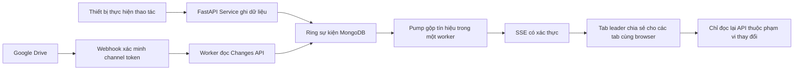

# MyHub: đồng bộ SSE, webhook Drive và lộ trình mở rộng

Tài liệu vận hành cho thay đổi ngày 09/11/2026. Đọc cùng [README.md](README.md), [hướng dẫn triển khai](MYHUB_DEPLOY_CICD.md) và [kết quả kiểm thử](VERIFICATION.md).

## 1. Phạm vi đã chốt

- Triển khai SSE + MongoDB hiện có, giữ backend **một worker**. Không thêm container, daemon, Redis hoặc thư viện runtime.
- Triển khai webhook Google Drive `changes.watch`, tự thay kênh trước khi hết hạn, kèm đối soát delta dự phòng ở backend.
- Redis **chỉ được mô tả để triển khai sau**, theo lựa chọn của người dùng. Chưa có adapter Redis, biến `REDIS_URL`, image Redis hay dịch vụ Redis trong source hiện tại.
- Không tự sửa `.env` cá nhân, cấu hình VPS đang chạy hoặc đăng ký webhook thật trong lúc kiểm thử source.

## 2. Luồng dữ liệu



Thiết bị tiếp tục upload/rename/share bằng REST API. Sau khi ghi thành công, Service phát tín hiệu chỉ chứa loại thay đổi và ID liên quan. SSE không truyền nội dung file hoặc thay thế API phân quyền.

Các thao tác được bao phủ: tạo/đổi tên/xóa/khôi phục Workspace; tạo folder; upload cũ và resumable; đổi tên/xóa/khôi phục file/folder; copy/move cả nguồn và đích; lưu text/lưu bản sao; khôi phục revision; thêm/sửa/gỡ quyền; cài đặt/thứ tự riêng từng browser; kết nối Drive và logout phiên.

Upload mở phiên, ghi chunk chưa hoàn tất, hỏi trạng thái chưa hoàn tất, hủy phiên và replay file đã hoàn tất **không phát event dữ liệu**. Hoàn tất được phát hiện qua GET status sau mất phản hồi vẫn phát event đúng một lần.

## 3. Giới hạn tải và tài nguyên

| Thành phần | Cơ chế hiện tại |
|---|---|
| Browser khi SSE hoạt động | Không gọi `/sync` định kỳ; một kết nối giữ mở, nhận heartbeat |
| Nhiều tab cùng profile/user/origin | Web Locks chọn leader, BroadcastChannel chuyển tín hiệu; không chia sẻ token |
| Tất cả tab bị ẩn | Nhường leader/dừng SSE; hiện lại sẽ đối soát |
| Browser thiếu Web Locks/BroadcastChannel | Một SSE mỗi tab, vẫn chịu giới hạn kết nối backend |
| Server khi có thay đổi | Gộp tín hiệu trong 150 ms, đọc một ring dùng chung cho các subscriber |
| Server khi không có subscriber | Không đọc ring định kỳ; mutation vẫn ghi log để thiết bị reconnect |
| Server khi có subscriber nhưng không có mutation | Một lần kiểm tra ring/30 giây cho cả worker; không theo số thiết bị |
| Browser khi nhận nhiều event | Gộp invalidation 200 ms; cache ngoài phạm vi được giữ nguyên |
| Google Drive dự phòng | Một worker đọc delta mặc định 300 giây, không phải mỗi thiết bị quét folder |
| Client chậm | Queue tối đa 4 batch, đầy thì chuyển thành reset; không chặn writer |
| Replay | Ring mặc định 256 event, cấu hình tối đa 1024; event lớn chuyển thành reset nhỏ |
| Mỗi user | Mặc định tối đa 8 kết nối SSE đồng thời; quá giới hạn trả 429 |
| SSE gặp lỗi | Backoff lũy tiến có jitter, tối đa khoảng 60–72 giây; `/sync` fallback tối đa một lần/phút/tab leader |

Mỗi kết nối vẫn dùng socket, RAM và có kiểm tra lại session khoảng mỗi phút; SSE không làm chi phí bằng 0. Không suy ra khả năng phục vụ VPS thực tế từ số subscriber trong test giả lập.

## 4. Replay và an toàn khi mất kết nối

`sync_log` giữ **một document theo Drive root** gồm epoch, sequence và một mảng event có giới hạn. Mongo cập nhật counter và `$push/$slice` trong cùng thao tác nguyên tử; không cần replica set hoặc transaction nhiều document. Nhờ vậy không có khoảng trống do lấy sequence rồi mới insert event ở thao tác khác.

Client gửi cursor bằng `Last-Event-ID`. Khi cursor còn trong ring, server replay phần bỏ lỡ. Khi cursor quá cũ, sai epoch, nằm trong tương lai hoặc batch quá lớn, server gửi `reset`; client đọc lại các API đang hiển thị. Startup/deploy thêm một reset mới vào log để bao phủ thay đổi do config/restore ngoài luồng ứng dụng.

SSE dùng `fetch` streaming với Bearer trong header. Token không nằm trong URL, localStorage, sessionStorage hoặc BroadcastChannel. Cursor công khai được lưu trong sessionStorage mỗi tab. Stream đóng khi JWT hết hạn; client dùng luồng refresh sẵn có rồi kết nối lại. Logout phát tín hiệu cho đúng session; các session khác tiếp tục hoạt động.

Mọi API dữ liệu vẫn kiểm tra xác thực/phạm vi như trước. Cài đặt được lọc theo user + browser trước khi gửi. Hai danh tính Google/GitHub được whitelist trong MyHub hiện cùng quản lý một Drive root; đây chưa phải mô hình nhiều tài khoản độc lập có quyền Workspace khác nhau.

Nếu Mongo ghi tín hiệu lỗi sau khi file đã được ghi trên Drive, ứng dụng không biến lần ghi file thành một lỗi giả để tránh người dùng retry tạo bản trùng. Kênh sync chuyển sang degraded và cố phát reset khi phục hồi. Với delta Google, cursor không tiến nếu tín hiệu chưa lưu được. Không thể tạo transaction nguyên tử chung giữa Google Drive và MongoDB; reconnect/reset và delta dự phòng xử lý khoảng trống do crash giữa hai hệ thống.

Bản nháp editor không bị thay bởi event. File sạch tự tải nội dung mới; file đang sửa báo conflict. File/Workspace mất quyền hoặc bị xóa không tự đóng viewer chứa bản nháp. Khi cây thay đổi trong dialog xóa Workspace, người dùng phải xem lại ảnh hưởng và xác nhận lại.

## 5. Webhook Google Drive

Endpoint: `POST /api/v1/sync/drive/webhook`, dùng cùng hostname MyHub. Không cần thêm DNS, subdomain hay OAuth scope: app đã có scope Drive đầy đủ.

Webhook không có Bearer MyHub. Service xác minh channel ID, hash token ngẫu nhiên, resource ID, thời hạn và message number tăng dần; callback trùng được ACK mà không làm thêm công việc. Token gốc chỉ dùng khi đăng ký với Google; Mongo giữ hash. Không tin User-Agent hoặc địa chỉ IP làm bằng chứng xác thực.

Google có thể gửi callback `sync` trước khi `changes.watch` trả về. Vì vậy source lưu kênh pending trước, xác minh callback sớm bằng token, rồi cập nhật resource ID mà không ghi lùi message number đã nhận.

Webhook chỉ đặt cờ dirty/đánh thức worker rồi trả 204; không chờ liệt kê file. Worker đọc `changes.list`, theo trang và lưu cursor. Kênh mới yêu cầu hạn 6 ngày, gia hạn trước hạn thực tế 6 giờ; Google quyết định hạn cuối. Sau khi kênh mới sẵn sàng, app cố dừng kênh cũ. Tối đa hai kênh được giữ trong state để xử lý giai đoạn giao nhau.

Chỉ ID thuộc root được phát trong tín hiệu file. Cây được kiểm tra qua chuỗi cha có cache trong một trang. `drive_sync_index` là index dẫn xuất có TTL 7 ngày để nhớ vị trí trước của file đã thay đổi, phục vụ move-out/xóa/mất quyền; không phải bản sao toàn bộ Drive. Tombstone không có metadata và chưa có vị trí đã biết được xử lý bằng **reset không chứa ID**, vì không thể xác định chắc phạm vi. Điều này có thể tạo một lượt đối soát thừa khi xóa file ngoài root, nhưng tránh bỏ sót thay đổi và không lộ ID ngoài phạm vi.

Nếu không đăng ký được webhook, đọc delta định kỳ vẫn tiếp tục. Nếu Google/DB lỗi, worker dùng backoff chung. Nếu cursor Google hết hiệu lực, app phát reset và lấy mốc mới. Khi không bật webhook và không có SSE subscriber, worker không gọi Google định kỳ; thiết bị quay lại sẽ đánh thức worker.

## 6. Cấu hình

Các giá trị mặc định đã có trong Settings; không bắt buộc thêm vào `.env` để SSE hoạt động.

| Biến backend | Mặc định | Ý nghĩa |
|---|---|---|
| `DRIVE_SYNC_ENABLED` | `true` | Bật worker đọc delta; không tắt SSE |
| `DRIVE_SYNC_INTERVAL_SECONDS` | `300` | Khoảng đối soát Drive dự phòng; phạm vi 60–3600 giây |
| `DRIVE_WEBHOOK_ENABLED` | `false` | Chỉ bật khi `BACKEND_URL` là HTTPS public |
| `SYNC_HISTORY_SIZE` | `256` | Số event giữ trong ring, 32–1024 |
| `SYNC_HEARTBEAT_SECONDS` | `25` | Heartbeat SSE, 5–60 giây; nhỏ hơn timeout proxy 110 giây hiện tại |
| `SYNC_MAX_CONNECTIONS_PER_USER` | `8` | Giới hạn SSE/user, 1–100; tab cùng browser có thể dùng chung một kết nối |

Local giữ `DRIVE_WEBHOOK_ENABLED=false`. Không trỏ webhook production vào local hoặc trộn Drive root dev với production. Không cần thêm cấu hình frontend hoặc cài npm/pip package mới.

## 7. Bật trên VPS hiện tại sau khi merge/deploy

Các lệnh dưới đây là hướng dẫn, **chưa được chạy lên VPS trong đợt phát triển source**. Chỉ thực hiện sau khi bản có `MYHUB_REALTIME_SYNC.md` đã được triển khai vào `/opt/myhub/current`.

### 7.1. Cập nhật systemd để restart không chờ SSE vô hạn

SSE là request dài. Bản unit mới có `--timeout-graceful-shutdown 15`; upload resumable có thể tiếp tục sau restart. Unit/script root không được CI tự ghi đè, vì vậy root chạy một lần:

```bash
install -m 644 /opt/myhub/current/deploy/myhub.service /etc/systemd/system/myhub.service
systemctl daemon-reload
```

Lệnh thứ nhất cập nhật unit có giới hạn graceful shutdown; lệnh thứ hai cho systemd đọc lại unit. Chưa restart ở bước này.

### 7.2. Bật webhook trong cấu hình production

```bash
nano /opt/myhub/shared/backend.env
```

Thêm hoặc sửa đúng một dòng mỗi biến, không tạo dòng trùng:

```dotenv
DRIVE_SYNC_ENABLED=true
DRIVE_SYNC_INTERVAL_SECONDS=300
DRIVE_WEBHOOK_ENABLED=true
```

Giữ `BACKEND_URL=https://myhub.liamcao.io.vn`, OAuth, Mongo URI và mọi khóa hiện có. Không chạy lại `init_config.py`, không sao chép đè `.env.example` lên cấu hình thật.

```bash
systemctl restart myhub.service
```

Backend khởi động, dùng credential Drive hiện có để tự tạo/gia hạn channel. Không cần người dùng gửi channel token, gọi curl chứa secret hoặc đăng ký thủ công Google Console cho mỗi channel.

### 7.3. Nginx và Cloudflare

- Route Cloudflare hiện tại giữ nguyên: `myhub.liamcao.io.vn` → `http://127.0.0.1:8080`, Path trống.
- Nginx hiện đã có `proxy_buffering off`, `proxy_request_buffering off`, timeout đọc 110 giây trong `/api/`. SSE trả `X-Accel-Buffering: no` và `Cache-Control` có `no-transform`; không cần thêm route riêng.
- Nếu bạn đã thêm Cloudflare Access, WAF rule/challenge hoặc cache rule từ sau lần deploy đầu, endpoint webhook phải nhận được HTTPS POST của Google mà không có trang login/challenge; `/api/*` không được cache. Chỉ điều chỉnh đúng endpoint/rule liên quan, không mở MongoDB hay backend ra Internet.
- Backend tiếp tục chỉ nghe localhost. Không thêm cổng public cho SSE hoặc webhook.

### 7.4. Quan sát

```bash
systemctl status myhub.service --no-pager
journalctl -u myhub.service -f
```

Trong DevTools → Network → Fetch/XHR, tìm `/api/v1/sync/events`: một request pending là trạng thái bình thường. Theo dõi frame `ready`, `changes`, `reset` và comment heartbeat; không còn `/sync` mỗi 2 giây. Khi có nhiều tab, chỉ tab leader cần mở request SSE.

Log `Drive webhook renewal unavailable; periodic reconciliation remains active.` cho biết worker đang dùng đối soát dự phòng: kiểm tra domain/tunnel, callback có bị challenge và cấu hình OAuth Drive. Không gửi `.env`, header Authorization, Cookie, `X-Goog-Channel-Token` hoặc kết quả Mongo document chứa channel state vào chat.

Sửa một file trên MyHub từ thiết bị thứ hai để quan sát sync nội bộ; sửa trực tiếp trên Google Drive để quan sát webhook. Những kiểm tra này tác động dịch vụ thật, chỉ làm với dữ liệu bạn chủ động chọn.

## 8. Backup, restore và chuyển VPS

File gốc và metadata người dùng tiếp tục giữ như quy trình cũ. Ba collection `sync_log`, `drive_sync_state`, `drive_sync_index` là state runtime/dẫn xuất: script backup không đưa chúng vào snapshot, restore bỏ qua cả khi archive cũ có chứa. Không phục hồi channel ID/token/cursor cũ sang một hệ thống khác một cách mù quáng.

Khi chuyển VPS, giữ root, OAuth, encryption key và dữ liệu ứng dụng theo [runbook chuyển VPS](MYHUB_DEPLOY_CICD.md). Giữ hostname nếu có thể. Chỉ một backend/worker Drive monitor được hoạt động với database production; dừng backend/connector cũ trước khi đưa backend mới ra phục vụ để không tạo hai Mongo độc lập hoặc hai monitor cạnh tranh. Backend mới tự tạo channel khi cần, client reconnect/reset để dựng lại cache.

## 9. Redis cho tương lai — chưa triển khai

### 9.1. Khi nào cần xem xét

Cần phân phối sự kiện tức thời giữa nhiều worker/VPS, hoặc đo tải cho thấy một worker không còn đáp ứng. Không thêm Redis chỉ vì số file trên Drive tăng; số kết nối, tần suất mutation, thời gian API và phạm vi cache ảnh hưởng tải trực tiếp hơn.

**Không chỉ đổi `--workers 1` thành nhiều worker.** Ngoài sync, app hiện còn khóa editor/upload trong RAM của một process. Muốn mở rộng phải xử lý đồng thời các khóa này, monitor leader và quyền truy cập; thêm Redis riêng lẻ chưa làm toàn hệ thống an toàn cho nhiều worker.

### 9.2. Điểm sửa code cụ thể

| Vị trí | Công việc khi triển khai Redis |
|---|---|
| `backend/app/repositories/sync_broker.py` — file tương lai, chưa tồn tại | Adapter Redis async, subscribe/publish thông báo đánh thức theo root/tenant |
| `backend/app/services/sync.py: publish/pump/start/close` | Sau khi Mongo append thành công thì publish wake; mọi worker subscribe và đặt `self.wake`; quản lý reconnect/cleanup broker |
| `backend/app/services/drive_sync.py: run/reconcile/ensure_channel` | Chỉ worker giữ lease hợp lệ mới đọc feed/tạo/gia hạn channel; có fencing/CAS khi commit cursor |
| `backend/app/controllers/sync.py: drive_webhook` và service notification | Callback tới worker bất kỳ vẫn đánh thức monitor leader qua broker sau khi cập nhật dirty |
| `backend/app/services/files.py`, `uploads.py` | Thay các khóa process bằng cơ chế phân tán/CAS phù hợp; kiểm thử save/upload đồng thời và mất lease |
| `backend/app/main.py` | Tạo/đóng pool Redis qua lifespan, tách vai trò API/monitor nếu cần |
| `backend/app/config/settings.py`, các `.env.example` | Thêm và validate cấu hình broker; tên biến phải được chốt ở lần triển khai đó |
| `backend/requirements.txt` | Khóa phiên bản Redis client và dependencies sau khi chọn phiên bản phù hợp |
| `deploy/compose.production.yml`, cấu hình riêng root | Thêm Redis có giới hạn RAM/log, auth/ACL, healthcheck; không publish cổng ra Internet |

Mongo ring vẫn là nguồn replay/cursor. Redis Pub/Sub chỉ đánh thức các worker để giảm độ trễ; nếu broker mất tín hiệu, pump đối soát Mongo dùng chung vẫn phục hồi. Không phát tín hiệu vào Redis trước khi ghi Mongo vì client có thể đọc thấy log chưa có event.

Redis Pub/Sub có thể bỏ lỡ thông báo khi subscriber offline, nên không dùng làm bản lưu duy nhất. Nếu đổi sang Redis Streams, phải thiết kế broadcast tới mọi worker có kết nối khách; một consumer group dùng chung cho toàn bộ worker chỉ phân chia công việc, không tự broadcast tới tất cả.

Lease leader cần owner ID, TTL, gia hạn và giải phóng có so sánh owner; có fencing/CAS để worker đã mất lease không ghi lùi cursor hoặc thay channel mới của leader khác. Không dùng khóa không có thời hạn hoặc xóa khóa của worker khác khi shutdown.

### 9.3. Trình tự triển khai sau này

1. Tạo nhánh riêng; kiểm tra trạng thái Git và giữ nguyên các thay đổi local có sẵn.
2. Đọc lại tài liệu này, đo số SSE/CPU/RAM/Mongo/Drive API và chốt mục tiêu tải, topology, phiên bản Redis/client. Hỏi người dùng trước khi thêm dịch vụ/cấp quyền trên VPS.
3. Viết adapter broker và lease/khóa phân tán tại các vị trí trong bảng. Thêm cấu hình mẫu, giữ mặc định một worker cho tới khi kiểm thử nhiều worker đạt.
4. Kiểm thử ít nhất hai backend cùng Mongo: mutation từ worker A tới client ở B, broker restart, subscriber mất kết nối, replay quá hạn, failover monitor, channel renewal, save/upload cạnh tranh và instance chết khi đang giữ lease.
5. Bổ sung cấu hình Redis/VPS cùng hướng dẫn backup, secret và giới hạn bộ nhớ. Khi broker lỗi, hệ thống phải phục hồi từ Mongo/reset thay vì mất tính nhất quán.
6. Triển khai hạ tầng đã được duyệt, sau đó mới tăng worker/instance và đo lại tải. Có phương án quay về một worker, giữ Mongo/Drive nguyên trạng và không xóa dữ liệu người dùng.

Mô hình hiện tại chỉ có chủ tài khoản quản lý một root. Nếu phát triển thành nhiều người dùng độc lập, cần thêm mapping user/root/quyền Workspace, phân vùng log/broker và xác thực subscription trước khi broadcast. Không tái sử dụng kênh global cho các tenant không liên quan.

## 10. File mới và nhiệm vụ

| File | Mục đích |
|---|---|
| `backend/app/dtos/sync.py` | DTO tín hiệu, cursor và header Google webhook |
| `backend/app/services/sync.py` | Ring/replay, batching, SSE, queue và giới hạn kết nối |
| `backend/app/controllers/sync.py` | HTTP status, SSE có Bearer và webhook có xác minh token |
| `backend/app/services/drive_sync.py` | Delta feed, scope, cursor/index và vòng đời channel Google |
| `frontend/src/services/sync.ts` | Parser SSE UTF-8 có giới hạn và chọn cache cần invalidation |
| `frontend/src/hooks/useLiveSync.ts` | Kết nối, leader nhiều tab, batching, backoff/fallback/reconnect |
| `backend/tests/test_sse.py`, `test_drive_sync.py` | Hồi quy replay, auth, tải logic, webhook/delta giả lập |
| `frontend/tests/sync.spec.ts` | SSE HTTP thật trong test, nhiều browser/tab, parser, UI và bản nháp |

## 11. Tham khảo

- [Google Drive push notifications](https://developers.google.com/workspace/drive/api/guides/push): payload rỗng, xác minh header, callback sớm và thay channel trước hạn.
- [Google Drive changes.list](https://developers.google.com/workspace/drive/api/reference/rest/v3/changes/list): phân trang, cursor và removed entries.
- [MDN SSE](https://developer.mozilla.org/en-US/docs/Web/API/Server-sent_events/Using_server-sent_events): định dạng frame, heartbeat và cursor.
- [Redis Pub/Sub](https://redis.io/docs/latest/develop/pubsub/): delivery semantics và giới hạn replay.
